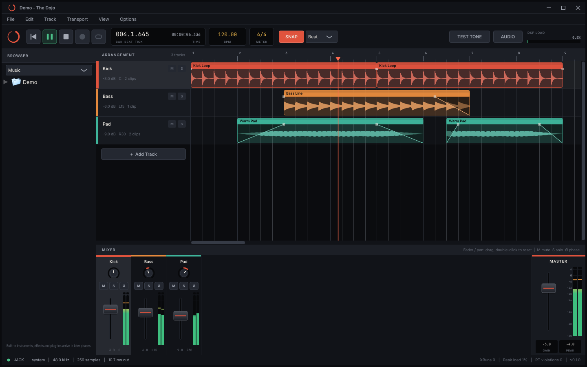

# The Dojo

A cross-platform digital audio workstation for **Windows and Linux**, with identical features on both. It is built in C++20 on JUCE, with a 64-bit floating-point mix engine and strictly real-time-safe audio code.



## What you can do today

- **Tracks.** Add, rename (double-click the name), recolour, reorder (drag the header) and delete tracks. Each has mute, solo and phase invert, volume and pan, and a live meter.
- **Audio clips.** Drag WAV, AIFF, FLAC, MP3 or OGG files from your desktop or the built-in browser onto the timeline, or use *File > Import Audio*.
  - Edit: move clips (also between tracks), trim either edge, drag the corner handles to fade, and split, duplicate or delete.
  - Waveforms are real.
  - Any source sample rate plays back at the right speed.
- **Timeline.** Snap to bar, beat, 1/8 or 1/16 (hold Alt or Shift to bypass), zoom with Ctrl+wheel, follow the playhead, and edit the tempo by dragging or typing.
- **Mixer.** A channel strip per track, plus a master fader and meter.
- **Undo and redo** for every edit.
- **Projects.** Save, open and New, as `.dojo` files. Audio paths are stored relative to the project file, so you can move the project folder.
- **Audio Settings.** Choose the driver, device, sample rate and buffer size; your choice is remembered.

Recording, MIDI and the piano roll, built-in instruments and effects, plug-in hosting, automation and export are next on the [roadmap](#roadmap). Controls for features that aren't built yet are visibly disabled.

## Using it

1. Drag audio files onto the arranger. Drop them on a track, or below the last track to create new tracks. You can also double-click a file in the browser.
2. Press **Space** to play. Click the ruler, or an empty part of a lane, to move the playhead.
3. Mix with the faders and knobs in the mixer, then save with **Ctrl+S**.

| Keys | Action |
|---|---|
| Space / Home | Play-stop / return to start |
| Ctrl+T, Ctrl+I | Add track, import audio |
| Ctrl+Z, Ctrl+Shift+Z | Undo, redo |
| Delete, Ctrl+D, Ctrl+E, Ctrl+A | Delete, duplicate, split at playhead, select all clips |
| Ctrl+G | Toggle snap |
| Ctrl+= / Ctrl+- / Ctrl+0 | Zoom in, out, to fit |
| Ctrl+N / Ctrl+O / Ctrl+S | New, open, save |
| Ctrl+, | Audio settings |
| F1 | All shortcuts |

Mouse:
- Right-click clips, track headers or empty lanes for context menus.
- Shift+wheel scrolls sideways.
- Double-click a fader or knob to reset it.

### Command line

```bash
TheDojo [session.dojo] [audio files...] [--audio-api=JACK|ALSA|ASIO|"Windows Audio"] [--play] [--test-tone] [--smoke-test[=secs]] [--version]
```

The log is written to `~/.config/TheDojo/TheDojo.log` on Linux and `%APPDATA%\TheDojo\TheDojo.log` on Windows. Settings go next to it.

## Building

### Linux

```bash
sudo ./scripts/setup-linux.sh
```

```bash
./scripts/build.sh            # Release; add `debug`, `--clang`, `--run`, `--no-tests`
```

The binary is at `build/linux-release/src/app/TheDojo_artefacts/Release/TheDojo`.

### Windows

Install Visual Studio 2022 or newer with the **Desktop development with C++** workload, which includes CMake, and Git. Then, from PowerShell:

```powershell
.\scripts\build.ps1           # Release; add -Config Debug, -Run, -NoTests
```

The binary is at `build\windows-msvc\src\app\TheDojo_artefacts\Release\TheDojo.exe`.

### Plain CMake

```bash
cmake --preset linux-release
```

```bash
cmake --build --preset linux-release
```

```bash
ctest --preset linux-release
```

Run `cmake --list-presets` for all configurations, including `linux-asan`, `linux-tsan` and `windows-msvc`. To build offline against an existing JUCE checkout, add `-DFETCHCONTENT_SOURCE_DIR_JUCE=/path/to/JUCE`.

Sanitizer presets need Clang's runtimes (`libclang-rt-<ver>-dev` on Debian/Ubuntu). On recent kernels, run TSan binaries under `setarch $(uname -m) -R`. ASan and TSan replace `operator new`/`delete` themselves, so those builds omit the real-time allocation trap, and the trap tests report SKIPPED.

## Tech stack

| | |
|---|---|
| Language | C++20 (GCC ≥ 11, Clang ≥ 14, MSVC 2022+) |
| Build | CMake ≥ 3.22 with presets, Ninja (Linux) / Visual Studio (Windows) |
| Audio, MIDI, plug-in hosting, GUI | [JUCE 9.0.4](https://github.com/juce-framework/JUCE), fetched and pinned automatically |
| Audio back-ends | Windows: ASIO, WASAPI, DirectSound. Linux: ALSA (incl. PulseAudio/PipeWire via ALSA), JACK (incl. PipeWire-JACK) |
| Tests | Catch2 v3 |

See [docs/ARCHITECTURE.md](docs/ARCHITECTURE.md) for the reasoning, the threading model and the real-time rules.

## Repository layout

```
cmake/        build options, compiler policy, pinned dependencies
docs/         architecture
resources/    embedded fonts
scripts/      setup and build helpers (bash + PowerShell)
src/core      real-time primitives (lock-free SPSC queue, RT allocation trap), musical time
src/engine    AudioEngine (audio thread), render graph, clip playback, device host
src/session   the document: tracks/clips with undo, audio file decoding, graph compiler, save/open
src/ui        arranger, mixer, browser, transport, menus, look-and-feel
src/app       application entry point, main window, settings
tests/        unit tests
```

## Roadmap

1. ✅ **Foundation**: stack, build system, real-time engine core, lock-free UI ↔ audio protocol
2. ✅ **Interactive baseline**: tracks, audio clips, arranger editing, mixer, undo, projects, audio settings
3. **Recording & MIDI I/O**: audio input routing and monitoring, recording, MIDI hot-plug, latency compensation
4. **Arranger depth**: busses, folders and routing, crossfades, time-stretch and pitch, multi-core graph, disk streaming
5. **MIDI sequencing**: piano roll, quantise, CC lanes, step sequencer
6. **Native DSP**: compressor, limiter, reverb, parametric EQ, delay, speed and pitch
7. **Instruments**: Drum Rack, Sampler
8. **Automation and export**: spline lanes, offline/real-time bounce, WAV/FLAC/MP3, stems
9. **Plug-in hosting**: VST3 + CLAP, out-of-process scanning

## Licensing

No licence has been chosen for The Dojo yet. Note that JUCE is AGPLv3 or commercial, and the bundled ASIO SDK is GPLv3 or a Steinberg licence. See [docs/ARCHITECTURE.md](docs/ARCHITECTURE.md#11-licensing-note). The embedded Inter and JetBrains Mono fonts are under the SIL Open Font License; see `resources/fonts/`.
