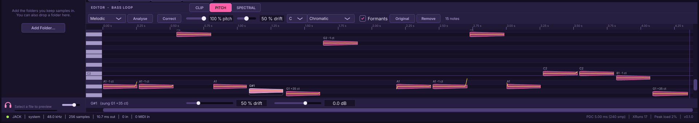
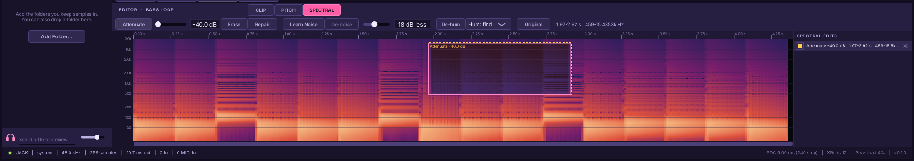
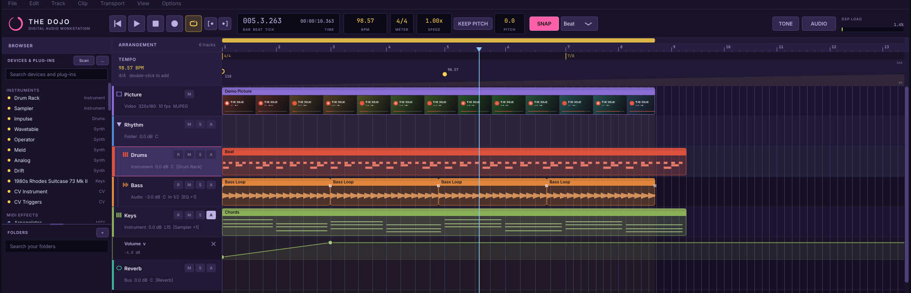
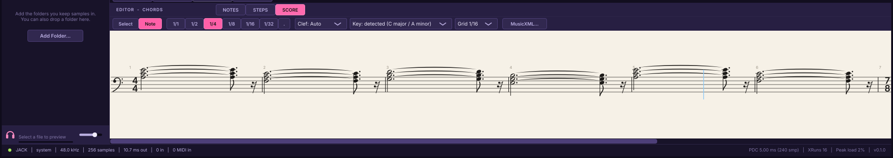
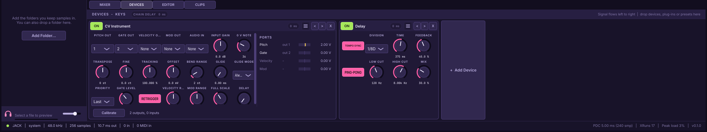

# The Dojo

A cross-platform digital audio workstation for **Windows and Linux**, with identical features on both. It is built in C++20 on JUCE, with a 64-bit floating-point mix engine and strictly real-time-safe audio code.


## What you can do

**Tracks and routing**
- Audio tracks, instrument tracks, busses (groups and effect returns) and **folders** (a folder is a bus that sums the tracks inside it; collapse it, nest folders, drag tracks in and out).
- Every track has volume, pan, mute, solo, phase invert, a meter, an **output** (the master, its folder or any bus) and **sends** (pre- or post-fader) to busses. Feedback loops are refused.
- Solo follows the routing: soloing a track keeps the busses it feeds audible, soloing a bus keeps its sources audible.
- **Plug-in delay compensation** aligns every path that meets at a bus, a folder or the master. Whatever arrives earlier waits for the latest arrival: a track by its own compensation delay, each send (pre- or post-fader) and each instrument aux output by an alignment delay of its own.
  - Sends leave their track before its compensation delay. So a track that plays to the master and also sends to a return with latency (a reverb return with a limiter, a parallel compression bus) lines up exactly with that return.
  - **Automation moves with the sound it shapes.** A track's fader, pan, VCA and send automation, and each device's parameter automation, are read as late as the sound at that point (behind a 10 ms lookahead, 10 ms later).
  - **Exports line up with the timeline.** The mix skips the whole project's delay. Each stem skips its own track's delay (a track inside a folder with latency meets that folder earlier than the master). The render runs long enough that nothing is cut at the end.
  - **The playhead and time show what you hear**: while playing, the position minus the delay to the speakers (the delay compensation plus the audio device's output latency). On a loop wrap they show the end of the loop for that moment.
  - Recording places takes where they were played (input, output and compensation latency removed).
- **Delay readouts**: you can see how much delay (latency) each device adds and what a whole chain adds up to.
  - **Each device** shows its delay in milliseconds in a badge in its header (in gold when it adds any). Hover the badge to see the samples and the chain's delay up to and including that device.
  - **The Devices panel's header** shows the whole chain's delay (CHAIN DELAY), the sum over the devices that are on. Its tooltip also gives the whole project's delay after compensation.
  - **The status bar** shows the project's delay compensation (PDC) in milliseconds and samples.
  - Everything follows changes as you make them: a lookahead or mode that changes a device's delay, bypassing a device (a bypassed device adds no delay), and the sample rate.
- **Device sends**: a send can take its signal from a device's own outputs instead of the track's: a console channel's bus assignments, aux and cue sends (the Harrison 4032). Each feeds a DAW bus, summed there with every other channel's, delay-compensated from where its device sits in the chain, and silent while its track is muted or soloed away. The mixer lists them on the track as "Bus 1-2 (Harrison 4032)". They go with their device and follow it into track copies.
- **Insert loops**: a device can hold devices of its own, which the engine runs inside it, between the device's send and its return. This is how a hardware unit's effects loop works. The Rhodes Suitcase's accessory loop is one (in series); the EMI TG12345's echo send is another (in parallel: the channel waits for the loop's latency so its echo comes back in time).
  - The loop's devices belong to the device's track. Their delay counts in the track's delay compensation (and in the Devices panel's readouts), their automation lanes sit on the track and follow the delayed sound, and their sidechains order the tracks and refuse feedback like any other.
  - They are saved with the project, copied with Duplicate Track (with fresh ids, their lanes following them), undone in one step with their host, and kept in chain presets.
  - Switching the loop off, or bypassing its host, takes the whole loop out of the signal path (and its delay out of the compensation). A device can offer its loop in some modes only (the TG12345: its Microphone and Echo / Aux cassettes); the Devices panel shows the loop while it is offered, or while it holds devices. Effects go into loops; instruments and the LFO do not. Loops run on mono and stereo tracks.
- The graph renders on **all CPU cores**: independent tracks run in parallel.
- Audio tracks and aux inputs (busses) are **mono or stereo**. A mono track plays its clips as one signal, or one chosen channel of each clip's file. It also records one input channel.

**Surround (multichannel)**
- Audio tracks, aux inputs, folders and the master can also be **3.1, 5.1, 7.1, the 3D (immersive) beds 5.1.4, 7.1.4 and 9.1.6, Dolby Digital or DTS**. Each format has one channel per speaker, in this order:

  | Format | Channels |
  | --- | --- |
  | 3.1 | L R C LFE |
  | 5.1 | L R C LFE Ls Rs (SMPTE/ITU) |
  | 7.1 | L R C LFE Ls Rs Lrs Rrs |
  | 5.1.4 (10) | L R C LFE Ls Rs Ltf Rtf Ltr Rtr: 5.1 and four heights (top front and top rear pairs) |
  | 7.1.4 (12) | L R C LFE Ls Rs Lrs Rrs Ltf Rtf Ltr Rtr: 7.1 and four heights |
  | 9.1.6 (16) | L R C LFE Ls Rs Lrs Rrs Lw Rw Ltf Rtf Ltm Rtm Ltr Rtr: 7.1, the wides and six heights (top front, middle, rear) |
  | Dolby Digital | L C R Ls Rs LFE (5.1 in AC-3 order) |
  | DTS | L R Ls Rs C LFE (5.1 in DTS order) |

- The speakers are where ITU-R BS.2051 (and the ADM common definitions) put them: L/R at ±30°, the surrounds at ±110° in 5.1 and 5.1.4 or at the sides (±90°) with rears at ±135° in the 7.x family, wides at ±60°, and the top layer 30° up, above the speakers it pairs with (±30° / ±110° in 5.1.4; ±45°, ±90° and ±135° in 7.1.4 and 9.1.6).

- Choose the format in *Track > New*, or later in the track's right-click *Format* menu. The **master's format** is set in the master strip of the mixer.
- A multichannel track plays multichannel files and records one input per channel (*In 3-8* for a 5.1 track on input 3).
- Signals move between formats **by speaker**, so a Dolby Digital track's centre plays from a 5.1 master's centre:
  - A track that feeds a smaller format is folded down (ITU style): the centre and surrounds go to the sides at -3 dB, and the LFE is dropped. Each height goes into the ear-level speaker below it at -3 dB (top front into the front, top middle into the side surround, top rear into the rear, or the surround when there are no rears), and a wide into the front and the surround (-3 dB each). A smaller format feeding a larger one keeps its speakers; the others get nothing.
  - Any number of tracks can play into a surround or 3D master or bus: each track's engine buffers grow to the channels it needs (16 for 9.1.6) when the graph changes, never on the audio thread.
  - How a surround master reaches your ears is set in **Preferences > Surround** (see *Surround monitoring* below).
- **Surround panner**: a mono or stereo track that feeds a surround bus or master gets a panner pad in its mixer strip. Drag to place the track (left/right is its pan, up/down front to rear). Right-click to set how much of a centred signal plays from the centre speaker (dialogue: 100 %). Double-click to reset.
- **3D panner** (immersive): **3D** in the pad's corner (or *Track > 3D Panner* in the track's menu) places the track anywhere in the room instead: around you, above and below.
  - **Azimuth** -180° to +180° (positive to the left, 0° ahead, 180° behind), **Elevation** -90° to +90°, **Distance** 0 (at your head) to 1 (at the speakers), **Size** 0 (a point) to 100 % (all around you). A stereo track's two sides sit 30° either side of its azimuth.
  - **3D VBAP**: the destination's speakers (heights included) are joined into a mesh of non-overlapping triangles on the listener's sphere. A source plays from the three speakers of the triangle around it, with the gains that solve p = g1·l1 + g2·l2 + g3·l3, normalised to constant power (g1² + g2² + g3² = 1). Where the speakers leave gaps, virtual speakers share their signal out at equal power: straight up and down (to the ring below) for a bed with nothing there, the middle of a face of more than three speakers (so a symmetric layout pans symmetrically, overhead included), and the space behind a 3.1 layout.
  - **Spread**: a larger size, or a source moving in towards you, plays from more of the speakers around it (energy-preserving multiple-direction panning: the powers of the directions over a cap around it are summed, up to the whole sphere at the centre), at the same loudness.
  - **Size** also makes it diffuse: its share of the power plays through a decorrelation filter per speaker (cascades of all-pass filters, 1 to 12 ms, each speaker its own), so the copies stay uncorrelated and the source is wide and enveloping rather than a phantom image.
  - In the mixer strip the pad becomes a small top view of the room: drag to place the track; double-click to open the full **3D panner window** (also *Track > Open 3D Panner...*).
  - **The 3D panner window**: the room as a wireframe box with the speakers (heights hollow), the listener and the source with a line down to the floor and a halo as wide as its spread. **3D** (perspective; drag the source to turn it around you, right-drag or Alt-drag to turn the room), **Top** (X / Y), **Side** (Y / Z) and **Rear** (X / Z) views: in the flat views dragging places it on the two axes you see, keeping the third (precise elevation in Side and Rear). Sliders for the four values. Shortcuts (Space plays ...) work in the window too.
  - **Trajectories**: **Add Keyframe** writes the position at the playhead into the track's 3D lanes; the trajectory is drawn through its keyframes (gold diamonds), and while it plays the source moves along it (its own setting stays faint underneath). Drag a keyframe to move it, right-click it to delete it; **Clear Trajectory** removes the lanes. Each is one undo step.
  - **3D automation lanes**: *3D Azimuth*, *3D Elevation*, *3D Distance* and *3D Size* (the lane menu's *3D Panner* submenu), drawn like any lane. The LFO can sweep them too. Azimuth automation moves through the values in between (from 180° to -90° it turns through the front); to cross behind, add keyframes on both sides of ±180°.
- **ADM objects (Dolby Atmos)**: *Track > ADM Object (Dolby Atmos)* on a 3D-panned mono or stereo track makes it an **object**: its sound leaves the mix as its own channel with its position, instead of being panned into the bed. A stereo track becomes two objects, its sides 30° either side of it. The mixer strip's room view and the 3D panner window show an **OBJ** tag.
  - While you monitor, an object is panned into the bed like any 3D-panned track, so you hear it in place.
  - In an **ADM BWF** export and on the **external renderer** outputs (*Preferences > Renderer*) objects leave the bed. Each is rendered after its fader, before the panner, delayed to line up with the master output. Its sends still feed their busses, so reverb returns stay in the bed.
  - Objects are numbered from 1 in the session's order (a stereo track takes two numbers), the same in the export, on the outputs and in ADM-OSC.
- **Effects on multichannel tracks**: every device and plug-in runs as linked instances, one per channel group. The speaker pairs (L/R, Ls/Rs, Lrs/Rrs, Lw/Rw, Ltf/Rtf, Ltm/Rtm, Ltr/Rtr) run as stereo pairs; the centre and LFE run on their own. All instances follow the first one's settings.
- Meters show one bar per channel (up to 16, wider strips for the 3D beds), and the arranger draws every channel of a multichannel clip when the track is tall enough. On the surround panner pad the top layer shows as hollow speakers.
- **Export**:
  - A surround master exports as a multichannel WAV or FLAC (FLAC holds up to 8 channels, so the 3D beds export as WAV). Stems have their destination's channels.
  - WAV files of 3.1, 5.1 and 5.1.4 carry their WAV channel mask (their order is the WAV standard one). 7.1, 7.1.4, 9.1.6, Dolby Digital and DTS are written as discrete channels in the format's own order (above), because the WAV mask order differs (7.1's mask puts the rears before the sides) or has no wides and top middles.
  - MP3 gets the stereo fold-down. Surround monitoring never changes what is exported: an export with the virtualizer (or any mode) on writes every channel as it is.
  - **ADM BWF** (Dolby Atmos masters, ITU-R BS.2076): one file with the bed (the master's channels: every track that is not an object) and each object's channel, plus the ADM metadata. Choose it under *Format* in *Export Audio*; it renders offline.
    - **Container (BW64, ITU-R BS.2088)**: `RIFF` or `BW64`, a `JUNK` chunk kept for `ds64`, `fmt`, `chna`, the audio in `data`, then `axml` after the audio. Past 4 GB the header becomes `BW64` and the `ds64` chunk holds the 64-bit sizes.
    - **chna**: maps each channel of the file to its audioTrackUID, with its track format and pack.
    - **axml**: the audioProgramme, an audioContent per bed and object track, and an audioObject for the bed and for each mono object. Beds use the common definitions (stereo, 5.1, 7.1, 5.1.4, 7.1.4; 3.1 and 9.1.6 get a pack of their own made of the common channels). Each object has its pack, channel, stream and track formats.
    - **Movement**: each object channel carries its **audioBlockFormat**s, in Cartesian coordinates (x, y, z from polar through the ITU-R BS.2127 room mapping), with width = height = depth from its size and its gain. Blocks follow the engine's render blocks, with sample-aligned times written to 10 µs. A block holds where the object has got to by its end. Blocks that stay put, or that a straight move between their neighbours passes within 0.0001, are merged.
    - **Threads**: the export thread renders, tracks in parallel on the engine's workers, while a writer thread encodes and writes, so rendering and disk writing overlap.
    - Files open in any WAV reader, which plays the channels and ignores the ADM chunks.

**Surround monitoring** (*Options > Preferences > Surround*): how a surround master plays on stereo headphones or speakers. The meters always show every channel.
- **Standard**: the channels as they are, one output per channel. On a stereo device you hear only the front left and right.
- **Classic Fold-Down** (the default, what earlier versions did): an output per channel when the device has enough; otherwise the ITU-R BS.775 stereo fold-down (centre and surrounds at -3 dB, the LFE left out).
- **Advanced Surround Virtualizer**: binaural rendering of every speaker at its standard place, 2 m away in a room 5 m wide, 6 m long and 2.7 m high. It plays on outputs 1 and 2, also on a device with more outputs.
  - Ear level: L/R at ±30°, C at 0°, surrounds at ±110° in 5.1 and ±90° in 7.1, rears at ±150°, wides at ±60°.
  - Heights: the top layer of 5.1.4, 7.1.4 and 9.1.6 plays 30° up (as the ADM common definitions place it). Ltf/Rtf are at ±30° in 5.1.4 and ±45° otherwise, Ltm/Rtm at ±90°, and Ltr/Rtr at ±110° in 5.1.4 and ±135° otherwise.
  - Each speaker reaches each ear five ways, each path from its own direction in 3D: directly, and as first reflections off the floor, the ceiling, the nearest side wall and the front or back wall. A top speaker's ceiling reflection arrives first and steeply from above (about 1.9 ms after the direct sound); its floor reflection arrives late, from far below.
  - Every path uses the Brown–Duda spherical-head model, with the angle to each ear taken in 3D:
    - The interaural time difference follows Woodworth's formula (0.26 ms for the front speakers, 0.66 ms at the side, 0.49 ms for a top speaker at the side), as a fractional delay. A source above is less lateral.
    - The head shadow is a first-order filter: up to +6 dB of treble at the near ear, about -20 dB in the head's shadow.
  - A pinna model gives each path the spectral cues for its elevation and front/back:
    - **Elevation:** the first pinna notch rises with elevation, from 4 kHz straight below through 6.9 kHz at ear level and 8.3 kHz at the top layer to 12 kHz overhead. It is 12 dB deep, fading towards the zenith. A source above also gets Blauert's overhead band at 8 kHz, raised by up to 4 dB.
    - **Behind:** sources behind get a high shelf, down to -8 dB at 4 kHz.
    - **Level:** the notch and the overhead band are made power-neutral, so a top speaker is heard above the bed at the bed's level.
  - A short four-line feedback-delay-network reverberation (0.35 s) puts the sound outside the head.
  - The LFE plays on both sides below 120 Hz. A full mix plays at the fold-down's level.
  - **Headphones** or **Speakers**: for speakers, a recursive crosstalk canceller (for speakers at ±30°, band-limited to 250 Hz – 6 kHz) keeps each ear's signal to that ear.
  - **Room** (0–100 %): 0 % is anechoic (closer, inside the head); more gives more reflections and reverberation.
- **Device 3D Virtualizer**: sends the surround channels to the device in its own channel order, so the device's built-in virtualizer renders them. That can be a 7.1 gaming headset, a USB surround card, an AV receiver, or the system's spatial sound (Windows Sonic, Dolby Atmos for Headphones, DTS Headphone:X).
  - Channel order: WAVE/WASAPI order (L R C LFE BL BR SL SR) for most drivers, ALSA's own (L R RL RR C LFE SL SR) on ALSA.
  - The tab shows how many outputs the current device has and has on; **Use All of Its Outputs** turns on outputs 1–8.
  - A stereo-only device gets the Advanced Virtualizer instead. Headsets often offer 7.1 only with their surround mode, or the system's spatial sound, switched on.
  - A 3D bed reaches such a device as 7.1: its heights and wides folded into the layer below (as above).
- The tab also says what plays right now (for example "the Advanced Virtualizer, for headphones").

**Track menu**
- **New...** (Ctrl+Shift+N) adds one or more tracks in one go. Each row is a count, a format (mono or stereo), a type and a name; + and - add and remove rows. The tracks go after the selected track (inside its folder) or at the end. The types:
  - audio track, aux input (a bus), instrument track or folder (audio tracks, aux inputs and folders in any format: mono, stereo, 3.1, 5.1, 7.1, 5.1.4, 7.1.4, 9.1.6, Dolby Digital or DTS);
  - **MIDI track**: MIDI clips (and live MIDI when armed) that play the instrument track picked in its menu (*MIDI Output*). Muting it silences its notes; soloing the instrument keeps it playing.
  - **VCA Master**: no audio of its own. Its fader (and volume automation) scales its member tracks, its mute mutes them and its solo solos them; VCAs can be nested. Assign tracks with *VCA* in the track menu (it applies to the whole selection).
  - **Master Fader**: one last fader, with mute, volume automation and post-fader devices, on the main output or on a bus (*Controls* in its menu; one per path).
  - **Video Track**: video clips for scoring to picture (see *Video* below).
  - **Click Track**: a mono aux input with the **Click** device already inserted (also *Track > Create Click Track*).
- **Duplicate...** (Alt+Shift+D) makes any number of copies of the selected tracks. You choose whether the copies get the clips, automation, devices (with their current settings) and sends. Each copy goes right after its source, or all of them after the last selected track. A folder is copied with its contents; routing inside it points at the copies.
- **Delete** removes the selected tracks (undoable). Deleting a VCA Master coalesces it: its fader and automation are added into each member's own volume (and a muted VCA mutes them), so they sound exactly as before.
- Duplicating a VCA member without *VCA assignment* bakes the VCA's gain into the copy the same way.
- **Split into Mono** gives each selected stereo or multichannel audio track one mono track per channel ("Name.L", "Name.R", and for surround "Name.C", "Name.LFE", "Name.Ls" ..., for the 3D beds also "Name.Ltf", "Name.Lw" ...).
  - Each one is placed at its speaker: pan, front/rear, and the centre speaker for C.
  - Each plays and records that channel.
  - Each gets the source's devices, sends and automation; the source track stays.
- **Make Inactive / Make Active**: an inactive track (or everything in an inactive folder) is not played and its devices use no CPU. Tracks routed into an inactive bus are silent. Inactive tracks are dimmed and can't be soloed, muted or recorded.
- **Clear All Clip Indicators** (Alt+C) clears the red clip lights of every meter, in the mixer and on the master. They light when a signal goes over 0 dBFS and stay lit until cleared.
- **Scroll to Track...** takes a track number (or a pick from the list), selects that track and brings it to the top of the arranger (opening collapsed folders) and the left of the mixer.

**Video**
- **File > Import Video...** (Ctrl+Shift+I), or drop a video file on the arranger.
  - The video goes onto a video track (the one it's dropped on, or the first one; a new one at the top if there is none), at the playhead or the drop point.
  - The **Video window** (*View > Video*, Ctrl+Shift+V) opens. It shows the picture at the playhead while playing, locating and scrubbing, with the timecode (hh:mm:ss:ff at the video's frame rate) and the clip's name.
- Video clips show a **filmstrip** of their frames and edit like audio clips: move, trim, split, copy and paste, Edit and Time Lock. Muting a video track hides its picture, and the topmost video track with a clip at the playhead is the one shown.
- Frames are decoded in the background, so the picture never holds up the interface or the audio.
- Formats:
  - **Motion-JPEG AVI** on every platform (built in).
  - **MP4, MOV, MKV, WebM, AVI** (H.264, HEVC, VP9, ProRes, ...) with **FFmpeg** on Linux, found at build time (`libavformat-dev libavcodec-dev libswscale-dev`, installed by `scripts/setup-linux.sh`).
  - **Windows Media Foundation** on Windows (MP4, MOV, AVI, WMV with H.264, HEVC, ...).
- The demo project has a short picture track.
- **The mix in the movie** (*Export*, Format **Video**): a copy of the video clip's movie with the mix as its only sound, for the stretch of the timeline the clip covers.
  - The picture is copied packet by packet, not re-encoded. No loss: the same codec, size and frame rate. It takes seconds.
  - Sound and picture stay in step as they play in the session.
    - A copy can only start on a key frame, so it starts at the movie's key frame at or before the clip's start, which may be a little before the clip. The mix is rendered from there (with silence for any part before the timeline's start).
    - It ends with the clip. With B-frames, a frame or two just after the end can be in the copy, because frames before the end are predicted from them. The sound ends with the clip.
  - **AAC**: 320 kbps for each pair of channels (stereo 320, 5.1 960), up to 7.1. A bigger mix (5.1.4, 7.1.4, 9.1.6) goes in as stereo unless you choose PCM.
  - **PCM 24-bit**: lossless, every channel.
  - The speakers are named in the file in the container's order. Dolby Digital and DTS orders are reordered, 5.1 is FFmpeg's "5.1" and 7.1 its "7.1".
  - Containers:
    - **Linux (FFmpeg)**: the movie's own (MP4, MOV, MKV, AVI, ...). WebM becomes MKV (it holds neither AAC nor PCM). With PCM, an MP4 becomes a MOV, because QuickTime's PCM is what editors read.
    - **Windows (Media Foundation)**: an MP4 with AAC (mono, stereo or 5.1, 44.1 or 48 kHz, up to 192 kbps).
    - **Every platform (built in)**: a Motion-JPEG AVI, with PCM.
  - It uses the first video clip of the first video track that plays (active, not muted). Only that clip goes in: an edit of several clips would need the picture re-encoded.
  - A looped clip, or a speed other than 1.00, is refused with a reason.

**Recording and MIDI**
- Pick each audio track's input (mono channel or stereo pair), arm it (R) and record (R key or the record button). Each track's monitoring is AUTO, IN (always the input) or OFF.
- **Track > Set Record Tracks to Input Only / Auto Input** decides what record-enabled tracks on AUTO hear:
  - **Input Only**: always their input.
  - **Auto Input** (tape-machine style, the default): the input while stopped. While playing, the track's own clips. While recording, the input from the punch-in point to the punch-out point, and the clips before and after.
- **Punch In / Punch Out** (the buttons next to the loop button, or the Transport menu) use the loop range. A take keeps only what lies between the punch points; red brackets in the ruler show them.
- **Space** (or Stop) while recording ends the recording and keeps the take, as Record does.
- Recording over earlier material keeps every take in **take lanes** (below). With *Record Takes to Lanes* off, a take replaces what was on its track where it lies. Either way one undo removes the recording whole.
- MIDI keyboards are enabled automatically, also when plugged in while The Dojo runs. Armed instrument tracks play and record live MIDI (notes, controllers, pitch bend, channel pressure, polyphonic aftertouch).
- **MPE controllers** (Seaboard-, LinnStrument- or Osmose-style; the MPE lower zone, one note per channel 2–16): each note's own **pitch bend, pressure and slide** (CC 74) are recorded as that note's expression curves, ready to edit in the piano roll's Note Expression lanes. The values a channel had when its note started are where the note's curves begin.
  - Set in *Preferences > General > MIDI Input*: **MPE controllers** on or off (on by default) and the controller's **per-note pitch bend range** (48 semitones, the MPE default, or 24, 12, 2). With it off, those channels' bends, pressure and slides record as controllers on their channels, for a keyboard that sends on channels 2–16 without being an MPE controller.
  - Channel 1 (the zone's master channel) and chords played on one channel always record as ordinary controllers. Polyphonic aftertouch is always its note's pressure.
- Recorded clips are placed with **latency compensation** (input + output + plug-in latency).

**Take lanes and comping** (playlists)
- Audio, instrument and MIDI tracks can keep **takes** in **take lanes** under them. The track's own clips are the **comp**: what plays. The takes in the lanes do not play.
- **T** in a track header shows or hides its take lanes (it appears once the track has some, with how many). *Track > Take Lanes > Show Take Lanes* (Shift+T) does it for the selected tracks.
- **Record Takes to Lanes** (Transport menu, on by default): a take goes into a take lane of its own ("Take 3") and is comped in when it is recorded over earlier material or onto a track that has take lanes. The earlier material goes into a take lane too, if none holds it yet. A first take onto empty space stays a plain clip.
- **Loop Record** (Transport menu, Shift+L): with the loop on, recording cycles the loop and each pass becomes a take in its own lane (all from one file), the newest comped in.
  - A last pass shorter than a quarter of the loop is dropped (Stop came just after the loop came round).
  - Punch In or Out turn it off: they use the loop range as theirs.
  - MIDI takes work the same way, a clip per pass.
- **Swipe comping**: drag across a take lane and that stretch of the take goes into the comp, replacing what was there (silence where the take has none). It snaps to the grid unless Alt or Shift is held. **Click** a take to comp all of it.
  - The parts of each take that are in the comp are lit, and each lane says how much of it is.
  - Comp clips name the take they came from ("Vocal [Take 2]").
- **Quick crossfades**: every edit in the comp gets a short crossfade (*Transport > Comp Crossfade*: 10 ms by default; 5, 20, 50 ms, or Off for plain cuts). It is centred on the edit where both sides have audio.
  - Between takes it is equal power.
  - Where the same take goes on (its gain changed, say) it is equal gain, so nothing dips or swells.
  - Where the comp meets silence, a quick fade.
  - Swiping more of a take that is already in the comp extends that stretch as one clip, and its other edit (and crossfade) stays where it was.
- **Audition** a take: **S** on its lane plays the lane instead of the comp (the comp is dimmed meanwhile). S again goes back to the comp.
- A lane's menu (right-click): Comp Whole Take, Audition, Rename (or double-click its name), Delete Take Lane.
- *Track > Take Lanes*: New Take Lane from Comp (keeps a version of the comp), Delete Unused Take Lanes, Delete All Take Lanes (the comp stays as it is).
- Takes are saved with the project; duplicated tracks keep their takes; files used only by takes count as used in the Clip List. Every comp is one undo step.

**Editing**
- Audio clips: move (also across tracks), trim, fades, split, duplicate, cut/copy/paste; overlapping clips **crossfade** (equal power).
- Selecting clips like files in Explorer: **drag a box** in empty space (Ctrl/Shift adds to the selection), **Ctrl+click** adds or removes a clip, **Shift+click** selects every clip on that track from the last clicked one (Ctrl+Shift+click adds that range).
- Selecting tracks the same way, in the track headers (or on mixer strips): **Shift+click** selects every track from the last one clicked to this one, **Ctrl+click** adds or removes one track, **Ctrl+Shift+click** adds a range. Then:
  - **Ctrl+Shift+G** or *Group into New Folder* puts all of them into one new folder, in their order. Tracks from different folders are moved in too.
  - Dragging one of their headers moves them all (drop them inside a folder to move them into it).
  - M, S and R on one of them switch all of them.
  - The right-click menu's colour, output, move into or out of a folder and delete apply to all of them.
- Stereo clips show **both channels** (left above right), mono clips one waveform.
- **Time-stretch and pitch-shift** per clip (Signalsmith Stretch), plus per-track speed and pitch.
- Global **speed** (varispeed, or *keep pitch*) and **transpose**.
- Long files **stream from disk** instead of being loaded into memory.
- Loop range (drag in the ruler's top strip, L toggles), snap, zoom, undo/redo for everything.

**Audio editing** (in the clip editor, for audio clips: **CLIP**, **PITCH**, **SPECTRAL**)
- **Pitch editing (PITCH)**: native, graphic pitch correction of vocals and instruments, monophonic and polyphonic.
  - **Analyse** finds the notes: **Melodic** for one voice (vocals, bass, a solo: a YIN pitch track cut into notes at pitch changes and new attacks, vibrato kept as the note's drift) or **Polyphonic** for chords (piano, guitar, pads: the strongest fundamentals of each moment by harmonic summation, their partials cancelled and the next one found, linked into notes).
  - Each note is a **blob** on a pitch grid, as thick as it is loud, with its **pitch drift** drawn through it and, once moved, a faint outline of where it was.
  - **Drag a note** up or down to change its pitch (in semitones; Alt: freely, in cents) and, in melodic material, sideways to move it in time; **drag its ends** to change its timing (a neighbour it touched follows). **Double-click** snaps a note to the nearest note of the **scale** (chromatic, major, natural or harmonic minor, major or minor pentatonic, from any root). **Correct** moves the selection (or all notes) towards the scale by **Pitch %** and straightens its drift by **Drift %**. Below: the selected notes' **drift** (0 % straight, 100 % as performed, 200 % exaggerated) and **level** (-24 to +12 dB). Keys: Up/Down a semitone (Shift: 10 cents), Delete resets the selection, Ctrl+A, Escape.
  - **Formants** (melodic) keeps a voice's character when its pitch moves (the spectral envelope stays where it was), so a voice moved up does not sound small. **Original** plays the clip as recorded (A/B). **Remove** takes the edits off.
  - In polyphonic material each partial moves with the note it belongs to, so one note of a chord changes alone; timing edits are for melodic material.

  
- **Spectral editing (SPECTRAL)**: the clip's **spectrogram** (log frequency from 20 Hz), showing the result of its edits.
  - Drag a **time-frequency box** (Shift: all frequencies), then **Attenuate** (or **Boost**) it by the gain shown, **Erase** it, or **Repair** it (rebuilt from the sound around it: each frequency's level interpolated across, its phase carried on, for clicks, coughs, chair squeaks, a phone).
  - **Learn Noise** from a stretch of noise alone, then **De-noise** the selection's time (or the whole clip) by up to the reduction shown (spectral subtraction with smoothed gains against "musical noise").
  - **De-hum** notches mains hum and its harmonics (50 or 60 Hz, or found in the clip and refined to a twentieth of a hertz).
  - Each edit is drawn on the spectrogram and listed beside it: tick to bypass, cross (or Delete) to remove. **Original** for A/B.

  
- **How edits are heard**: every edit is one undo step. The clip keeps its own file; the edited parts (and only those, cached part by part) are rendered in the background, spectral edits first and pitch edits on their result, into a 32-bit float file beside the project (*Song Edits*), loaded, and then played by the clip. Undo renders again. A project opened without its renders makes them again; exports wait for renders still running.

**Clip menu** (also in the clip's right-click menu; each command applies to all selected clips, and selecting a clip of a clip group selects the whole group)
- **Edit Lock / Edit Unlock** (Ctrl+Shift+L): an edit-locked clip (padlock in its title bar) can't be cut, deleted, split, trimmed, faded or moved (in time or to another track). Its notes, gain, stretch and pitch are read-only in the editor. Copies of it, pasted to any track or time, are edit-locked too. (It locks the selected clips, or unlocks them if all are locked; Time Lock likewise.)
- **Time Lock / Time Unlock** (Ctrl+Alt+L): a time-locked clip (clock in its title bar) stays at its time location. It can't be moved in time or deleted, but it can be trimmed, split or dragged to another track at the same time. When it is split, both parts stay time-locked.
- Recording over a locked clip leaves it as it is. Delete and cut skip locked clips, which stay selected.
- **Rating** (None, 1–5; Ctrl+Alt+0…5): rate takes from 1 (lowest) to 5 (highest); none is the default. Ratings show as stars in the clip's title bar (or on its group's bar), and *View > Clip Ratings* shows or hides them.
- **Group** (Ctrl+Alt+G): makes a clip group of the selection: audio, MIDI and video clips on one or more tracks, and other clip groups (which nest inside it). A group has one title bar with its name over its clips; it is selected, moved, copied and deleted as a whole, and its clips can't be trimmed or faded until it is ungrouped.
- **Ungroup** (Ctrl+Alt+U): unpacks the top layer of the selected groups only; nested groups stay. **Regroup** (Ctrl+Alt+R) puts back what the last Ungroup took apart (after you edited its clips). **Ungroup All** removes every layer at once.
- **Loop...** (Ctrl+Alt+O): an audio, MIDI or video clip repeats a number of times (a loop arrow in its title bar, a notch where each iteration starts). Drag its right edge to draw out more (or fewer) loops; its left edge moves it. **Unloop** turns it back into one standard clip per iteration, which can be edited one by one.
- **Capture...** (Ctrl+Alt+C): the selection becomes a new clip in the **Clip List**: a range dragged over in an empty part of the lanes (the marquee is also the time selection, shown as a band on the tracks it covers), or else the selected clips. It works on one track, and across clips only when they play contiguous material of the same file (as the parts of a split clip do), or within one loop of a looped clip. Drag the clip from the Clip List onto a track to place it there.
- **Rename...** (Ctrl+Shift+R): renames the clip. A renamed clip that editing created (a split part, a copy, an import) becomes a user-defined clip, listed in the Clip List even when auto-created clips are hidden.
- **Identify Sync Point** (Ctrl+Alt+S) at the playhead: a small down arrow at the bottom of the clip with a light grey line, and the sync point's SMPTE time (30 fps) when the clip is selected. Moving the clip snaps the sync point, not the start, to the grid, and trimming the start keeps it on the same audio. **Remove Sync Point** takes it away.
- **Quantize to Grid** (Ctrl+Alt+Q): moves the selected clips so that their sync point (or start, when there is none) is on the nearest line of the grid chosen in the transport's grid pop-up. Time- and edit-locked clips stay.
- **Warp**: audio played to the grid, or to the feel you want, without leaving the arranger.
  - **Detect Hitpoints** (Ctrl+Alt+H): finds the attacks in the part of the file each selected audio clip plays. It uses spectral flux of log-compressed STFT magnitudes with an adaptive threshold, and places each attack to the sample on the 30 % point of its energy rise. A selected clip shows its hitpoints as small ticks along its bottom; they are saved with the project.
  - **Warp markers** (gold lines with a handle under the title) pin a moment of the source to a time in the clip. The audio between two markers is time-stretched to fit, without changing its pitch; the clip's start is pinned to where it starts, and after the last marker the clip plays at its own stretch. **Drag** a marker to move that moment in time (it snaps to the grid, and Alt bypasses snapping); the neighbouring stretches follow, never faster than 4x the source's speed and never past another marker. **Shift + double-click** in a clip adds a marker there, **double-click a hitpoint's tick** adds one on that attack, and **double-click a marker** removes it. The waveform is drawn warped.
  - **Warp Markers at Hitpoints**: a marker on every hitpoint, where it plays now (nothing moves until you drag them).
  - **Quantize Warp Markers** (Ctrl+Alt+W): moves the markers onto the nearest lines of the transport's grid, so the attacks land on the beat and the audio between them stretches to fit. A clip that has hitpoints but no markers gets them at its hitpoints first: Detect Hitpoints, then Quantize, corrects a loose performance in two steps.
  - **Clear Warp Markers**: the clip plays straight again.
  - Splitting, trimming the start and Render Clip Gain keep every moment of the audio where it played. Each part of a split keeps the markers on its side, plus one at the split.
- **Clip Gain** > **Bypass Clip Gain** (Ctrl+Alt+B): the clip plays without its clip gain; the setting is kept (shown as "(bypassed)" next to the gain). **Render Clip Gain** writes the clip's audio with its gain applied to a new file (in "<session> Rendered" next to the session), plays that instead and resets the gain to 0 dB. Undo brings back the original.

**Clip List** (the **CLIPS** tab, F6). It lists the **whole-file clips** (one per imported, recorded or rendered file, in **bold**; a clip on a track that plays a whole file is that clip), captured clips, user-defined (renamed) clips, the MIDI clips on tracks and the clip groups. **Auto-created** clips, made as a by-product of splitting, copying, pasting or unlooping (and audio clips that play part of a file), are listed only when asked for. Drag rows (several at once) onto a track to place them there one after the other; a clip dropped on a track that can't hold it, or a group's clip past the last track, gets a new track of the right kind; groups keep their layout. Double-click a row to rename it. Clips selected in the list are selected in the arranger too. The **CLIP LIST** button (or a right-click) opens its menu:
- **Show**
  - Clip types: **Audio**, **MIDI**, **Video**, **Groups**, **Auto-Created**.
  - Clip information: **Color** (the colour of the track the clip is on), **File Type** (audio, MIDI, video or group), **Timebase** (MIDI is tick-based, audio and video sample-based), **Processing State** (an Elastic Audio mark on time-stretched or pitch-shifted clips), **File Name**, **Disk Name** (the volume label and drive on Windows, the mount point on Linux).
- **Select**: **All**; **Unused** (not placed on any track); **Unused Except Whole Files**; **Offline** (their files can't be found). Offline clips are italic and dimmed in the list, and light blue with italic names in the arranger.
- **Sort By**: Clip Type, Name (natural order: "Take 2" before "Take 10"), Length, Original Time Stamp, User Time Stamp, Timebase, Start in Parent, End in Parent; for audio and video also File Name, File Length, File Creation Date, File Modification Date, Disk Name, Track Format/Width, Channel Name and Scene and Take (from a file's iXML, or names such as "Sc12 Tk3"). **Ascending** or **Descending**. MIDI clips have no file values and go last.
- **Auto Rename...**: Name (the root), Number (to start from), Zeros (digits at least) and Suffix. The selected clips are renamed in order ("Verse_007.v", "Verse_008.v", ...), and clips later made from them by splitting, duplicating, pasting or unlooping continue the numbering. It changes clip names only, never the files.
- **Time Stamp...**: shows the clip's **original time stamp** (when its first sample was recorded: a file's BWF time reference, or where it was recorded or first placed, plus the clip's start in the file) and sets its **user time stamp** (SMPTE, 30 fps; *Current Time* takes the playhead's). With several clips, the others move by as much as the first. Both are saved with the session, and splits keep them consistent.
- **Rename...**, **Export Clips as Files...** (audio as 32-bit float WAV of the clip's part of the file, MIDI as a Standard MIDI File; video is skipped), **Remove from Clip List** (whole-file and captured clips; the clips on tracks stay).
- The options are remembered.
- Not available yet: Pro Tools-style **playlists** (alternate takes on a track and its playlist lanes), so there is no showing or hiding of playlist lanes by rating. Ratings are saved with each clip, ready for that.

**Tempo map** (*View > Tempo Track*, Ctrl+Alt+T: a lane over the tracks)
- **Tempo changes** anywhere in the song, each a **jump**, a **linear ramp** (accelerando, ritardando: the tempo moves evenly per beat to the next change) or a **curve** (bend it: fast then slow, or slow then fast). Double-click the tempo lane to add a change on the grid; drag a point along the bars and up or down (Alt: finer); right-click for its shape, bend, exact value or removal. The BPM field in the transport shows and sets the tempo where the playhead is.
- **Time signatures** at any bar (7/8, 6/8, 5/4, 3/4 ... mixed meters for film cues): the strip at the top of the tempo track, or click the signature in the transport. The ruler, grid, snap, bar|beat|tick display, click (counting the signature's beats, the downbeat accented) and loop-to-bar follow them.
- **Timing is exact**: within a ramp the time is closed-form (seconds = 60 / k · ln(tempo / start tempo)); a curve is a chain of short ramps, within a fraction of a millisecond.
  
- **What follows the tempo**: MIDI clips are musical (they keep their bars and beats, their notes and loops in place when the tempo changes); audio, video, automation and time-locked clips keep their time. Instruments, the LFO's sync, the click, recording, MIDI export (tempo and signature meta events), ARA plug-ins (the tempo map and bar signatures as their musical context) and control surfaces all read the map. Every edit is one undo step and saved with the project.

**MIDI sequencing**
- **Piano roll**: draw, move, resize and delete notes; velocity lane; **controller lanes** (mod wheel, volume, pan, expression, sustain, pitch bend, channel pressure); **quantise** with strength and optional note ends.
  - **Note Expression (MPE)** (the last entry of the lane menu): three lanes under the notes, **Pitch** (per-note bend in semitones), **Pressure** (polyphonic key pressure) and **Slide** (CC 74), each showing every note's own curve under the note. Each note's bend is also drawn over the note itself in the grid.
    - **Drag** in a lane to draw the curve of the selected notes, or with none selected, of the notes playing where you draw. **Shift+drag** draws a straight ramp. **Right-drag** erases points. **Double-click** clears that curve. Pitch snaps to whole semitones near them.
    - Click the pitch lane's name to change its scale: 12, 24, 48 or 2 semitones up and down.
    - Right-click notes > *Note Expression* clears their pitch, pressure, slide or all.
    - Curves belong to their notes (stored from the note's start): they move and quantise with them, and go with them when a clip is copied, duplicated or split. Every stroke is one undo step.
  - **Playback**: a clip with note expression plays as **MPE**. Each note gets a member channel of its own (2–16, round robin, the least recently used free channel first) with its bend (±48 semitones), channel pressure plus polyphonic aftertouch, and CC 74, sent before the note starts and then every 128 samples while it changes. Drift and Meld (MPE on by default) and MPE plug-ins play each note's own curves; set a plug-in's per-note bend range to 48 semitones.
  - **Scroll bars** move left and right through the clip (and up and down through the notes); also Shift+wheel, and Ctrl+wheel zooms.
  - **Click a key** on the keyboard to hear its note through the track's instrument, for as long as you hold the mouse button: long samples and sustained synths keep sounding until you let go. Further right on a key plays louder; slide up or down to play other keys. It works with the transport stopped and the track not armed, also on edit-locked clips (MIDI tracks play through their instrument track), and nothing is recorded.
- **Score** view (Clip Editor > **SCORE**): the clip in **staff notation**, written and edited on the staff.
  - Engraved from the notes: treble, bass or a **grand staff** (automatic from the notes' range, or chosen), the **key signature** (detected from the notes, or chosen from the 15 keys), the tempo map's bars and **time signatures**, notes and **rests** in notatable values (dotted where they sit on the beat, rests showing each beat), **ties** over bar lines and beats, chords, **accidentals** (sharps in sharp keys, flats in flat keys, naturals where a note leaves the key, once per bar and line), ledger lines, stems, flags and **beams** (with 16th and 32nd beams and hooks; dotted-quarter groups in 6/8 and 12/8), bar numbers as in the arrangement and the playhead. The notation rounds to its grid (a 16th by default); the notes themselves do not change.
  - **Note tool** (N): click to put in the chosen value (whole to 32nd, dotted) on the grid, at the pitch of that line or space in the key (Shift: a semitone up, Alt: down); you hear it. **Select tool** (S): click or lasso notes and drag them along the grid and up or down the staff (in the key). Keys: Delete, Up/Down (Ctrl: an octave), Left/Right a grid step, 1-6 for whole to 32nd (the selection's, or the tool's), "." dots, Ctrl+A, Escape. Right-click deletes a note. Every edit is one undo step; clef, key and grid are kept with the clip.
  - **MusicXML...** exports the clip's score (MusicXML 4.0: key, time signatures, clefs, two staves for a grand staff, pitches as spelled, durations, dots, ties, beams, rests) for notation programs such as Dorico, Sibelius, Finale or MuseScore.
  - The score shows the clip's content once (a looped clip is not repeated). Tuplets are written as the nearest straight values.

  
- **Step sequencer** view of the same clip: rows are the Drum Rack's pads or Impulse's slots (or 16 notes), click or paint steps, right-click for velocity. Click a row's name to hear it while held.

**Native devices** (64-bit, real-time safe, with dedicated editors; drag a knob, or double-click the value under it to type an exact one: "120 Hz", "2.5k", "-6 dB", or a word the knob shows, such as "Off", "Full" or "-inf")
- **EQ**: 4 bands (low/high cut, shelves, peaks) with a live spectrum analyser and draggable band handles.
  - **Spectrum overlay**: **OVERLAY** lists the project's other tracks; tick up to four and their spectra are drawn over the EQ's own, each in its track's colour and named in the legend (they are post-fader, so they show what you hear). It is for seeing where parts fight over the same frequencies, such as a kick and a bass.
  - **Sidechain visualizer**: the EQ has a sidechain input. Pick a track in the device's header and its spectrum shows as "SC <track>", whether or not that track is also an overlay.
  - **MASK** (on by default) shades the frequencies where another track is about as loud as this one or louder, darker the more it masks it: none 6 dB under it, half level with it, full 6 dB over it, ignoring anything under -60 dB. The readout names the worst stretch and the track doing it, e.g. "MASKED 60 - 110 HZ BY KICK".
  - The chosen overlays and the MASK switch are saved with the project. A track is only tapped while an EQ shows it (up to 16 tracks at a time, any number of EQs), and costs nothing otherwise.
- **Compressor** with soft knee, makeup, mix and an **external sidechain** (pick any track).
- **Limiter** (lookahead brickwall):
  - **Maximize**: Threshold replaces Input Gain. Material at the threshold comes out at the ceiling, so lowering the threshold reduces the dynamic range and makes the track louder.
  - **Auto Release**: a fast path recovers within ~20 ms after short peaks. A slow path only engages under sustained limiting, so dense material does not pump.
  - **Stereo** or **L/R**: Stereo gives both channels the same gain reduction. L/R limits each channel on its own peaks, and **Link** blends between the two (100 % = Stereo).
  - Modes:
    - **Standard**: transparent.
    - **Soft Clip**: lets peaks up to 6 dB over the ceiling reach a saturation curve, which rounds them off below it for warmth and crunch.
    - **True Peak**: an 8x-oversampling detector keeps the peaks between samples under the ceiling too, for streaming and CD delivery. It adds 8 samples of latency, compensated automatically.
- **Reverb** (feedback delay network) and tempo-synced **ping-pong delay**.
- **Plate Reverb**: the dense, bright, smooth sound of a studio plate (after Dattorro's plate algorithm: four input diffusers into a modulated figure-eight tank with fourteen output taps). Three pages:
  - **Plate**: the material (**Steel**, the classic studio plate; **Gold Foil**, smaller, denser and brighter with tight lows; **Aluminium**, larger, more open, shimmering), Pre-delay (0 to 250 ms, or **Sync**ed to the tempo: 1/64 to 1/4), Decay (0.2 to 20 s to -60 dB), Size, Damping, Dry/Wet.
  - **Tone**: **Low Decay** (25 to 200 % of the decay below **Low Freq**: a warmer or a tighter tail; the tank splits its feedback in two bands), Bandwidth (the input's brightness), Low Cut, High Cut, Width.
  - **Motion**: Diffusion, Mod Rate and Mod Depth (a slow wobble that keeps long tails from ringing), **Drive** (the plate's driver saturating when pushed), **Ducking** (the reverb steps back while the dry signal plays and blooms in the gaps), **Freeze** (holds the tail forever, new input ignored).
  - The display shows the decay of the lows, mids and highs after the pre-delay (or FROZEN). Short decays with little pre-delay make the classic short vocal plate.
- **Echo**: two-line tape-style delay (stereo, ping-pong or mid/side; synced or free, linked or not) with resonant filter, time and filter modulation, drive, noise, wobble, ducking, reverb before/after/inside the feedback loop, width.
- **Utility**: gain ±35 dB, width 0–200 % and Mono, Bass Mono (below a crossover), phase invert left/right, channel mode (left, right, swap), balance, mute, DC filter.
- **Amp & Cabinet**: seven amp models (Clean to Heavy, and Bass) with 4x-oversampled gain stages, bass/middle/treble/presence, five cabinets and three microphone positions.
- **Pitch Shift** for live input and instruments.
- **HW Insert**: outboard gear (a compressor, an EQ, a tape machine, a guitar pedal) patched into a track like a plug-in. The track leaves the computer through the sound card's outputs, goes through the hardware, and comes back on its inputs.
  - **Send To / Return From**: stereo pairs or single channels of the sound card, listed by their names. A mono send carries the sum of both sides; a mono return feeds both. Channels the sound card doesn't have are marked; Preferences > Audio switches more on.
  - **Send** and **Return** levels (+-24 dB) with meters, **Phase** (flips the return), **Dry/Wet** (blends in the signal as it was, delayed to meet the return).
  - **The round trip** (the sound card's buffers both ways plus the converters) becomes the device's latency, so delay compensation lines up the hardware's return with every other track.
  - **PING** measures it. A 0.15 s sine sweep goes out on the send, the return is recorded for half a second, and the round trip is where the two correlate best (an FFT cross-correlation), exact to the sample, even through EQ, transformers and some noise. The device is silent while it pings. The sign of the peak gives the polarity (PING switches **Phase** on when the hardware inverts) and its height the loop's gain. **MATCH** then sets Return so the loop comes back at the level it was sent. The panel shows the correlation with its peak, the round trip in samples and milliseconds, and the sample rate and buffer it was measured at.
  - **Auto Ping** (on by default) measures by itself when the device first runs and whenever the sample rate, the buffer or the channels change. It only does this while the transport is stopped, and it tries once per setup when nothing comes back. Until a measurement exists, the driver's reported latency stands in. **Offset** nudges the delay compensation by a few samples; **Ping Level** sets the sweep's level (-30 to -6 dBFS).
  - A return channel the sound card lacks lets the signal pass through. Exporting a project with a HW Insert is real-time only: the export dialog switches to **Real time**, since the hardware can only be heard as it plays.
- **Click**: a metronome that follows the transport's tempo, bar position and time signature, sample-accurately. It has four sounds (Beep, Woodblock, Rim, Cowbell), volume, an accented downbeat, and quarter, eighth or sixteenth clicks. It plays during playback and recording, or only while recording.
  - **Own Tempo**: off (the default), the click always plays at the project tempo, whatever its own **Tempo** says. On, it plays at its own Tempo (20–400 BPM, two decimals), independently of the project: **x2** and **/2** double or halve it (and turn Own Tempo on), **= Project** copies the project tempo into it. The panel shows which tempo the click is playing at. Its beats count from the start of the timeline at its own tempo.
  - **Tempo detection**: the Click's panel lists the audio tracks. Tick one, or several (kick, snare, overheads...); selecting audio tracks in the arranger ticks them. **Detect Tempo** measures each track to two decimal places (for example Kick 121.12, Snare 121.48) and averages them.
    - If the average differs from the project tempo, it asks whether to set the project to it. **Set Project Tempo** does that later (one undo step). **Set Click Tempo** gives the detected tempo to the click alone (Own Tempo), leaving the project as it is.
    - The **range** (70–180 BPM by default) decides between half and double time; **/2** and **x2** correct the result afterwards. A track read at half or double the others' tempo is folded to agree before averaging, and shown as such.
    - How it works:
      - Onsets come from the spectral flux of the whole spectrum and of the band below 300 Hz (kick and snare body).
      - A comb over the onsets' autocorrelation, with a tempo prior around 120 BPM, gives the beat.
      - Each attack is timed to the sample on the energy envelope and numbered on the sixteenth-note grid.
      - A least-squares line through (number, time), weighted by onset strength and refitted without outliers, gives the tempo. Over 20 s of a steady part it is accurate to well under 0.01 BPM.
    - Clips count as placed: offsets, stretch and loops included. MIDI tracks follow the project tempo, so they are not measured.

- **Channel EQ**: a console channel strip: Low Cut (80 Hz), Low shelf (100 Hz), a Mid bell sweepable from 120 Hz to 7.5 kHz with console-style proportional Q (broad for small moves, narrower for big ones), High shelf (8 kHz) and output, with its response curve.
- **Auto Filter**: an analog-modelled filter swept by an LFO and an envelope follower.
  - Low-, high-, band-pass, notch, or **Morph** (from low-pass through band-pass and high-pass to notch); 12 or 24 dB.
  - Circuits: **Clean** (exact), **Warm** (OTA, its resonance saturates), **Ladder** (four-pole transistor ladder, 2x oversampled) and **Diode** (screaming resonance); Drive pushes them.
  - LFO: eight shapes, free or synced (1/64 to 8 bars), offset and stereo phase (180 degrees: one side opens as the other closes). The envelope follower opens or closes it with the level, of the input or of a **sidechain** track. The curve shows the cutoff moving.
- **Gate**: Threshold, Return (hysteresis, so a signal at the threshold does not chatter), Attack, Hold, Release, Floor, **Flip** (passes only what is quiet), **Lookahead** (opens before a transient; reported as latency), an external **sidechain** through high- and low-pass key filters, and Listen.
- **The Glue**: an analog-modelled bus compressor after the big British consoles of the 80's, for smooth, transparent glue on drums, groups and whole mixes.
  - **The circuit**, simulated sample by sample at the oversampled rate: a **feedback** topology (the gain cell turns down the main signal and the detector's input too, so the detector hears the compressed signal; the loop is solved implicitly every sample, so even the fastest attack at 10:1 never overshoots or chatters) and a **diode-based envelope follower** (a capacitor charged through a diode with a soft turn-on and discharged through the release; **Auto** release adds a slower capacitor that only charges while compression is demanded: fast after short peaks, slow on dense material).
  - Threshold, fixed Ratios (2:1, 4:1, 10:1), stepped Attack (0.01 to 30 ms) and Release (0.1 to 1.2 s, or Auto), Makeup.
  - **Mix** crossfades dry and compressed inside the oversampled domain (phase accurate at every frequency); it reads in decibels: the level of the compressed signal (0 dB fully compressed, -6 dB half, -inf dry).
  - **Range** saturates the sidechain: the top of the detected signal is clipped away, so there is at most that much compression however loud it gets. **Full** keeps the cleanest circuit; lower settings behave like older units, or limit the pumping creatively.
  - **Sidechain High Pass**: a soft -6 dB/oct high-pass on the detected signal (Off, or 20 Hz to 2 kHz). **External Sidechain**: another track drives the detector (through the same loop).
  - **Peak Clip** (PEAKCLIP IN): a soft-clipping waveshaper rounding peaks just under 0 dBFS after the makeup; oversampling keeps its harmonics from aliasing.
  - **Oversampling**: separate settings for real-time use and offline renders (2x and 8x by default), each Off (no latency, the lowest CPU), 2x, 4x or 8x, with **Minimum Phase** (the lowest latency), **Intermediate** or **Linear Phase** filters (the highest latency, the best phase alignment of the upper frequencies). Every setting has a whole number of samples of latency at DC, reported to the delay compensation (the page shows it for real time and offline: 2x linear phase is 50 samples, 8x 65).
  - **VU meter**: the white needle shows the RMS compression (VU ballistics). Click the meter to show the yellow **Peak** needle (held briefly, then falling); the choice is saved with the device. Hover over it to read the RMS and Peak compression in dB below it.
- **Expander**: the opposite of a compressor.
  - **Downward**: below the threshold quiet sound is made quieter by the ratio (2:1: 1 dB under becomes 2 dB under), at most by Range; a gentler alternative to a gate for room noise, spill and breaths. **Upward**: above the threshold loud sound is made louder (restoring punch that compression took away), at most by Range.
  - Knee; **Hysteresis** (once open it only closes that many dB under the threshold, so a level hovering at the threshold does not chatter); Attack, **Hold** (waits before closing), Release; Output and a latency-aligned Dry/Wet.
  - **Detector**: Peak (follows transients) or RMS (follows loudness); **Lookahead** (1 to 10 ms) opens it before a transient arrives, so the first hit is never cut; an external sidechain with a **Key High-Pass** and **Key Low-Pass** (so only the right part of the sound drives it) and **Key Listen**.
  - The displays: its curve with the level, and a history of the level, the threshold and the gain change.
- **De-Esser**: tames sibilance ("s", "sh", "t") and harsh highs.
  - **Band**: the sibilance lives **Above** Frequency, or in a **Band** between Frequency and High (the air above is left alone).
  - **Detection**: **Absolute** compares the band's level with the Threshold (dBFS); **Relative** compares it with the whole signal (the highs' share), so the same setting works whether the singer whispers or belts (quiet passages are left alone).
  - Over the threshold it turns down (4:1, soft knee) by at most Range, within half a millisecond, and lets go over Release: only the band (**Split**, crossovers that sum back flat) or the whole signal while the "s" lasts (**Wide**).
  - **Lookahead** (1, 2 or 5 ms): the gain is already down when the "s" starts. **Stereo**: Linked, Unlinked, **Mid** or **Side** only. **Listen**: **Trigger** (what the detector hears, to find the sibilance) or **Delta** (what is being removed).
  - The display shows the detector's band and a history of the sibilance level, the threshold and the reduction.
- **Soft Clipper**: rounds off peaks so they never pass the Ceiling, for loud drums and mixes without a limiter's pumping.
  - Input (with **Auto Gain** to judge the clipping at the same loudness), Ceiling, Shape (**Soft**, **Smooth**, **Hard** or **Tube**: a gradual, second-order bend), Softness (where the rounding starts), **Asymmetry** (the negative half clips earlier: even harmonics like a single-ended tube stage), **Stereo Link** (both sides clipped by the same amount: the image stays put), Output and a latency-aligned Dry/Wet.
  - **Listen**: Delta plays only what the clipper removes.
  - **Oversampling** as in The Glue (real time and offline, Off to 8x, minimum to linear phase). **Ceiling Guard** holds the ceiling after the downsampling filter too; off, heavy clipping with oversampling is at its cleanest (no aliasing at all), with peaks up to about 1 dB over the ceiling.
  - The display shows the curve and how much it clips.
- **Multiband Dynamics**: three bands (Linkwitz-Riley crossovers that add back up flat), each with an **Above** threshold and ratio (over 1:1 compresses downward, under 1:1 expands upward) and a **Below** threshold and ratio (over 1:1 expands downward, under 1:1 compresses upward), gain, solo and on/off. Attack, release, peak or RMS detection, soft knee, Amount, output and dry/wet; the display shows each band's level, thresholds and gain change.
- **Roar**: three saturation stages for anything from subtle warmth to wild degradation.
  - Eleven shapes per stage (Soft Sine, Diode Clipper, Tube Preamp, Polynomial, Hard Clip, Rectifier, Tri Fold, Sine Fold, Bit Crusher, Fractal, Noise Injection), with amount, bias, a filter before or after it (low-, high-, band-pass, notch, peak) and a level; 2x oversampled.
  - Routing: **Single**, **Serial**, **Parallel**, **Mid/Side** (stage 1 on the mid, 2 on the side) or **Multiband** (one stage per band).
  - Modulation: two LFOs, an envelope follower and a smoothed random source through an 8-slot matrix (drive, tone, every stage's amount, bias and filter, feedback, dry/wet).
  - Feedback through a delay and a band-pass (time or synced, invertible), a glue compressor, output and dry/wet.
- **Pedal**: Overdrive (the clipping stage sees only the mids, blended with the clean signal), Distortion (harder, more gain) and Fuzz (biased transistor clipping that sputters); Bass, Mid (500 Hz or 1.5 kHz), Treble, Sub, output and dry/wet; 4x oversampled.
- **Overdrive**: a 1970s-style overdrive pedal: a band-pass in front (frequency and width), drive into soft diode clipping, tone, and **Dynamics** (how much of the input's attacks and swells come back through the clipping).
- **Redux**: sample-rate reduction (a jittering clock, with pre- and post-filters that can be switched off for full aliasing) and bit reduction (fractional bits, Shape for more resolution near zero, DC Shift for truncation grit).
- **Studer A800 Multichannel Tape Recorder** (in the browser as *Studer A800 Tape Recorder*): a multitrack tape machine's channel, with its complete electronic signal paths, switched as the machine's microprocessor switches them.
  - **Path**: **Input** (the live electronics only: input transformer, a line amplifier with +22 dBu of headroom and an ultrasonic low-pass, output amplifier and transformer, no tape), **Sync** (recorded to tape and played back off the record head: a wider gap, fewer highs, a stronger low-frequency contour ripple), **Repro** (played back off the dedicated reproduce head: the widest, flattest response, with **Repro HF** and **Repro LF** fine trims) and **Thru** (a hard-wire bypass: the input untouched, for straight-wire comparisons). **Auto Input** switches the tape paths to Input while the transport is stopped, as the machine does in Stop. Every switch crossfades in 20 ms (no clicks).
  - **Tape**: Speed (7.5, 15 or 30 ips) with its EQ standard (30 ips: AES, 35 us; 15 and 7.5 ips: NAB, 50 us + 3180 us, or CCIR, 35 us at 15 and 70 us at 7.5 ips). Four tape **Formulas** (Vintage, Classic, Hi-Output, Mastering: maximum output level, how gently they saturate, hiss, low-end bump and top end). **Cal Level** (+3, +6 or +9 dB over 185 nWb/m at 0 VU) and **Input** set how hard the tape is hit; **Bias** (3 dB under to 3 dB over: under is brighter and dirtier, over darker and cleaner). **Noise** adds the formula's hiss (about -88 dBFS at 15 ips, more at 7.5).
  - **How it is modelled**: the record pre-emphasis lifts the highs (and with NAB the deepest lows) before the tape's magnetisation saturates, and the playback EQ is its exact inverse, so quiet signals come back flat while loud highs (and NAB lows) saturate first, as on tape. About 3 % THD at the formula's maximum output level. The head bump gives the low-end punch, and the response follows the machine's specification: 30 ips about 50 Hz - 23 kHz and 15 ips about 25 Hz - 22 kHz (within 1 dB), 7.5 ips about 30 Hz - 16 kHz (within 1.5 dB). Levels: 0 VU = +4 dBu = -18 dBFS; the output stage delivers up to +24 dBm into 600 ohms (+2 dBFS) before it rounds off.
  - **Group** (1 to 4): every A800 in the same group moves together, like the channels of one machine: change a setting on one and the others follow; a machine joining a group takes its settings. **Oversampling** (real time 2x and offline 4x by default; minimum-phase filters: 4 samples of latency at 2x).
  - **The deck** (the display) shows the machine:
    - **Reels that carry what the machine plays.** On the master the tape is exactly as long as the arrangement; on a track it ends with the track's last clip. On a bus or folder it ends with the material feeding it: tracks routed or sending to it, its members, MIDI played into it, an aux track's instrument. With nothing there yet it is the arrangement; in an empty session it is a standard 2,500 ft reel. The length follows the session as clips change.
    - **The tape winds as on the machine.** At the start of the song all of it is on the left (supply) reel, and at its end all of it is on the right (take-up) reel. Each pack holds its share of the tape (its radius goes with the square root). Both reels turn clockwise at the tape speed over their own radius: the emptier reel spins faster, the real 14-inch NAB reel speeds at 7.5, 15 or 30 ips. The tape runs off the left pack, round its guide, past the erase, record and reproduce heads and the capstan, and onto the right pack, its tangents following the packs.
    - **Locates wind.** A jump of the transport (a click on the timeline, return to start, a loop) fast-forwards or rewinds the tape there, quickly and then slowing into the spot. The flanges blur at speed and the REW or FF lamp lights.
    - **The transport.** The tape timer (minutes, seconds, tenths) and the tape's length, the speed lamps (7.5, 15, 30), and the transport lamps: REW, FF, STOP, PLAY, REC (while recording) and END (past the tape's end, the tape all on the right reel).
    - **The meter bridge.** A VU meter per channel (0 VU = +4 dBu = -18 dBFS), the path lamps (INPUT, SYNC, REPRO, THRU; the chosen path outlined while Auto Input holds Input), and the settings printed along the deck's edge.
- **EMI TG12345** (1968, the first transistorised console at Abbey Road) as one device: a plug-in **Cassette** of the desk, picked with **Cassette**. Its controls change with the cassette.
  - **It looks like the desk**: grey hammertone metalwork in modules (one per column of controls, with its seams and screws), black bakelite pointer knobs with fluted skirts and their scales printed in black, grey push buttons that light red when on, black legend plates for the stud and selector switches, and the page keys as legends lit while their page shows.
  - **The cassette's face**, beside every page: a row of small white-faced meters (output L and R in dBu, the drivers' +24 in red; the compressor's gain reduction on Microphone and Group cassettes, the outputs' phase correlation on the Main), the TG12345 nameplate with the model and cassette and its REG lamp, the signal path lit where it acts, the lamps (Announce; Talkback, Dim, Mono, Cut), and the cassette's **fader** in its black slot: white-capped for the channel and group faders, red for the main mix. On the Echo / Aux cassette it is the return; on the monitor cassette, the control room level. Drag it, hold Shift for fine moves, double-click to reset.
  - **The console's standards**: +4 dBu nominal (-18 dBFS) and up to +24 dBu into 600 ohms (+2 dBFS) from the Type B line drivers, rounding off at their rails. With everything flat: 20 Hz - 20 kHz within 0.5 dB, under 0.1 % THD at +4 dBu (about 0.045 %). Inputs and outputs are transformer-balanced, the stud switches are exact, and every cassette regulates its own supply (the headroom never sags).
  - **The amplifier cards**, each a discrete transistor stage with its own rails and curvature: **Type A** (low-noise gain stages, the EQ's make-up and the mix amplifiers), **Type B** (push-pull line driver), **Type C1** (high-headroom buffer) and **Type E** (50 kOhm buffer feeding the echo send and the pan-pots in parallel).
  - **Microphone** (a dual-channel cassette: the track's left and right are channels A and B, or **Mono**: A alone): mic input transformer (1:2; its core saturates on loud deep lows), **Input Gain** stud switches (6 dB coarse, -18 to +30 dB, plus 2 dB **Fine**), Amplifier C1, the compressor / limiter, the EQ, Amplifiers A and E, the echo send and the **pan-pots** (two reverse-connected 11 kOhm pots into 22 kOhm mixing resistors: centre -7 dB, hard left / right 0 dB), the **Spreader** (Mk I: an M/S width matrix, 0 - 200 %), the channel **Fader** (off to +10 dB), Amplifier B and the output transformer. **Model**: Mk I (Spreader) or Mk II (Presence on the channel).
  - **Compressor / limiter** (Microphone and Group): **Out**, **Comp** (2:1) or **Limit** (7:1), a 1 ms attack, a feedback design (the rectified output controls the gain cell); **Hold** sets the threshold (dB re +4 dBu; below it the gain stays put, so quiet passages and noise are never pumped up); **Recovery** in six steps, 100 ms to 5 s (90 % of the gain back in that time); **Stereo Link**.
  - **EQ**, passive networks with make-up amplifiers, stud switches of +-10 dB in 2 dB steps, each calibrated at its frequency: **Bass** a 50 Hz shelf; **Treble** a 5 kHz bell when boosting and a 10 kHz shelf when cutting; **Presence** (Group, and Mk II channels) a bell at 0.5, 0.8, 1.2, 1.8, 2.8, 4.2, 6.5 or 10 kHz.
  - **Echo** (Microphone): **Echo Send** (pre- or post-fader) feeds the device's own insert loop, the echo chamber: drop a reverb or delay into it (at 100 % wet) in the Devices panel. **Echo Return** mixes what comes back into the channel's output, the channel itself delayed by the chamber's latency so they meet in time. The echo bus is mono, as on the desk; with nothing in the loop there is no echo.
  - **Group**: the sub-group's mix amplifier and gain, its compressor / limiter, Presence, the group fader, Amplifier B and the output transformer, in stereo.
  - **Main**: the master mix amplifier, **Main Fader**, output drivers and transformers. **Track Announce** puts the talkback microphone (route a microphone track into the device's sidechain input) or a 1 kHz line-up tone at +4 dBu on the main outputs. The display monitors the outputs and their phase correlation.
  - **Echo / Aux**: the master echo send and return, for a shared chamber on a return bus fed by your sends: **Send Master** into the insert loop (the chamber), **Return Master** and the return's width out. With nothing in the loop the send goes straight to the return.
  - **Control Room & Studio** (monitoring, last on the master): **Listen** to the **Control Room** (its level, **Dim** -20 dB, **Mono**, **Cut**) or to the **Studio** playback (its level, plus the talkback from the sidechain input while **Talkback** is held). Talkback dims the control room. Offline exports pass the signal through untouched (it is monitoring); a real-time bounce records what you hear.
  - **Oversampling**: real time 2x and offline 4x by default (minimum-phase filters, 4 samples of latency at 2x).
- **Harrison 4032** (1975 - 84, the in-line console of 32 buses and 40 to 56 inputs) as one device: a **Module** of the frame, built as one of its three **Revisions**. Its controls change with the module and the revision. No latency.
  - **It looks like the desk**: a black panel with white printing between walnut end cheeks, with a padded leather armrest along the front when the panel is tall enough. The knobs are grey with coloured caps that say what they do: red gains, blue frequencies, green Q, yellow aux sends, orange cue sends, black pans and white levels. The switches are illuminated squares lit in their function's colour: +48V red, PHASE and PRE yellow, EQ IN and FILTERS IN green, MIX blue, PAD and SHELF white, FLIP amber. The 32 routing switches light amber.
  - **The face**, beside every page: the wooden meter bridge with a cream VU meter for each output (VU ballistics), the HARRISON 4032 badge with the revision and its years, the revision's circuits, the EQ and filter curve on a small phosphor scope, the lamps, and the **long fader**: the channel's VCA fader on the I/O module, the master fader on the others.
  - **Revisions**, each with its own circuits:
    - **A** (1975 - 77): LM301A op-amps after discrete differential pairs, +-15 V (+22 dBu out), a slew-limited top end at full level; HF and LF bands peaking only; HMF / LMF at a fixed Q of 1.5; the filters switched in with EQ IN; dbx 202 / Allison EGC-101 VCAs (fast fader moves thump: control-voltage feedthrough); inverting bus summing (about -62 dB of crosstalk into the neighbouring buses).
    - **B** (1977 - 79): TL071 / TL072 FET op-amps, +-18 V (+24.5 dBu), lower distortion at high levels; **Shelf / Peak** switches on HF and LF; differential summing (crosstalk about -85 dB).
    - **C** (1979 - 84): NE5534 in the gain, summing and driver stages (the lowest noise and distortion), +26 dBu; continuously variable **Q** (0.5 - 3.0) on HMF and LMF; a 3-pole 18 dB/oct HPF from 20 Hz; a **FILTERS IN** switch of its own (track through the filters without the EQ); dbx 2150 VCAs with better control-voltage isolation (20 dB less thump).
    - Measured: 20 Hz - 20 kHz within 0.25 dB; THD at +4 dBu 0.010 % (A), 0.007 % (B), 0.003 % (C); at +20 dBu 0.13 %, 0.07 %, 0.04 %; EIN -128 dBu on the C (Noise on), 1 to 2 dB more on A and B.
  - **I/O Module** (in-line): two paths.
    - The **channel path** takes the track through the microphone input or the line input. The microphone input has a Jensen JT-115-K-E 1:10 transformer, **PAD** -20 dB, **PHASE**, **+48V** (switching it pops, as it does), and **MIC GAIN** +10 to +60 dB: the track enters as a microphone would, -18 dBFS = -36 dBu, so +40 dB is unity. The line input has **LINE TRIM** +-10 dB.
    - The **monitor path** takes the tape return: the device's sidechain input (route a playback track into it).
    - **FLIP** swaps the two (tracking / mixdown, click-free like the CMOS switches).
    - The channel path runs through **HPF** (12 dB/oct from 25 Hz, or the C's 18 dB/oct from 20 Hz, to 3.15 kHz) and **LPF** (12 dB/oct, 160 Hz - 20 kHz). Then the 4-band proportional-Q EQ (each band narrows as it is boosted or cut): **LF** 40 - 800 Hz, **LMF** 80 Hz - 1.5 kHz, **HMF** 800 Hz - 15 kHz and **HF** 800 Hz - 18 kHz, each +-15 dB, with **EQ IN** a hard bypass. Then the VCA **Fader** (off to +10 dB), the **Pan** pot (constant power, -3 dB centre; a balance for a stereo pair of modules) and **Mix** to the mix.
    - **Pan Mode**: Stereo, Quad (Front / Back) or LCRS (centre and surround on the quad outputs).
    - The monitor path has its own **Mon Level** and **Mon Pan**.
    - **Format**: Stereo (a linked pair of modules) or Mono. **Noise** adds the input stage's hiss (EIN).
  - **Sends**, on the module's own outputs, each connected to a DAW bus with a device send (see Routing above):
    - The 32 **routing switches** feed the bus pairs "Bus 1-2" ... "Bus 31-32". The pair's bus is made with its first assignment, and **Bus Pan** divides the channel between odd and even buses.
    - **AUX 1 - 4** (pre or post fader) feed "Aux 1" - "Aux 4".
    - **CUE 1 - 2** (level and pan, from the monitor or the channel path) feed "Cue 1" and "Cue 2".
    - The quad bus's channels 3 - 4 and the **Direct** output each have a bus of their own.
    - Put a Harrison in **Bus Master** on those busses: the sub-group, aux and cue masters.
  - **Bus Master**: a program sub-group, aux or cue master on its bus. It has an **Input Trim**, the summing amplifier, the **Master** fader and the line driver. The optional **Jensen output transformer** saturates the deep lows at high levels. **Solo** solos the bus.
  - **Master Section** (on the master): the mix's summing amplifier, **Master Fader** and line drivers (and transformer). Then the control room **monitor matrix**: **Source** is the mix, an external source or both. The external source is the sidechain input: pick the tape, a bus, the 2-track or an aux return under **EXTERNAL**. Both together are a quad fold-down. Then **Mono** and the monitor **Volume**. Offline exports leave the monitoring out: they are the mix.
  - Automation: the VCA fader, like every parameter, is automated with the DAW's automation lanes (the role the Allison / Harrison Auto-Set computers played).
- **Shifter**: pitch shifting (+-48 semitones, window size), single-sideband **frequency shifting** (inharmonic, bell-like; negative shifts down) and **ring modulation**; stereo spread, an LFO (free or synced, stereo phase), an envelope follower, and a feedback delay for rising or falling spirals.
- **Chorus-Ensemble**: **Classic** (two voices), **Ensemble** (three voices 120 degrees apart with a fast shimmer, string-machine style) or **Vibrato**; rate, amount, feedback (or inverted), width, warmth, a high-pass on the wet signal, output and dry/wet.
- **Auto Pan**: rhythmic volume and panning: amount, rate or synced division, eight shapes, Phase (180 degrees pans, 0 is a tremolo), Offset, Invert and Square (hard switching for choppy gating).
- **LFO**: moves any knob or slider in the project, and they move on screen as it plays.
  - **Map...** lists every track and the master: its fader, pan and sends, and every parameter of every device and plug-in on it. **Learn** outlines every device control in the project; click one to map it.
  - Up to eight targets, each with its own range (min and max). Removing a mapping puts the target back where it was; mappings are saved with the project and undoable.
  - Eight shapes, rate or synced division (locked to the song position), depth, offset, phase, jitter, smooth, hold, retrigger and invert. Bypassing it hands the faders back to their own settings.
  - The mixer's faders and pan knobs follow while an LFO, or automation, moves them; their values show in the accent colour.

**CV / Gate** (a group of their own in the browser): control voltages for **modular synthesizers** (Eurorack and the like) through a **DC-coupled** sound card (an Expert Sleepers ES-8 or ES-9, a MOTU or RME interface with DC-coupled outputs...). Each device sends its voltages straight to the sound card outputs chosen for its ports, beside the mix.
- **Full Scale** sets the volts at full scale (10 V on most DC-coupled Eurorack interfaces); **Delay** (up to 250 ms) holds the voltages back to meet audio delayed by delay compensation or the output path. Each port shows the voltage it sends; missing channels and a missing sound card are pointed out. Offline exports have no sound card, so the voltages go nowhere then.
- **CV Instrument** (an instrument): MIDI to **1 V/octave pitch** (from the **0 V Note**, with Transpose, Fine, Bend Range, **Glide** always or legato, and Last, Lowest or Highest note priority), **gate** (Gate Level, Retrigger between legato notes), **velocity** and **mod wheel** voltages. **Audio In** brings the modular's audio back into the track (with Input Gain) to hear, mix and record it.
  - **Calibrate**: with Pitch Out patched to the oscillator's 1 V/oct input and its output to Audio In, steps of 0, 1, 2 and 3 V go out, the oscillator's pitch is measured at each, and **Tracking** and **Offset** are set so that every note plays in tune (an oscillator that tracks 2 % flat or sits 12 semitones off is corrected to a few cents).

  
- **CV Triggers** (an instrument): eight trigger or gate outputs, each for a MIDI note (drum modules), with trigger length, level and optional velocity level.
- **CV Clock**: a clock at the session's tempo (1, 2, 4, 8, 12, 16, 24 or 48 pulses a quarter note) with pulse width and **swing**, a **run** gate while the transport plays and a **reset** pulse when it starts.
- **CV Utility**: a voltage between Minimum and Maximum from an automatable **Value**, plus an LFO (sine, triangle, saw, square, random), slewed: automation lanes and the LFO device drive the modular's controls.
- **CV In**: a voltage from a sound card input as a **modulation source**, mapped like the LFO device (**Map...** or **Learn**) to any control in the session: a fader, a pan, a send, any device parameter.

**Instruments**
- **Wavetable**: two morphing wavetable oscillators (eight band-limited tables), unison up to 8, sub and noise, multimode filter, three envelopes, two LFOs and an 8-slot modulation matrix.
- **Operator**: 4-operator FM with 11 algorithms, per-operator waveform, ratio or fixed frequency, envelope and velocity, feedback, filter with envelope, pitch envelope and LFO.
- **Sampler**: polyphonic, ADSR, root note, tuning, start/end and loop; drop a file on it.
- **Drum Rack**: 16 pads (drag samples onto any pad from the browser or the file manager), per-pad volume, pan, pitch, choke groups and **outputs** — one click creates a return track for each pad output (multi-out).
- **Impulse**: 8 sample slots (drag onto any slot) with start, transpose, drive, transient, decay, filter, pan, volume and velocity per slot; slots 7 and 8 can choke each other (hi-hats).
- **Analog**: vintage subtractive synthesis.
  - Two band-limited oscillators (sine, saw, rectangle with width and PWM, noise) with octave, semitone, fine tuning, pitch modulation by LFO 1, and a balance between the two filters; oscillator 2 can hard-sync to oscillator 1. Noise with colour.
  - Two filters (12 dB state-variable and 24 dB transistor-ladder low-, band- and high-pass, notch) with drive, key tracking, an envelope each and LFO 2, in parallel or in series.
  - Two amplifiers with their own envelopes, levels, pans and tremolo; two LFOs (free or synced) per voice.
  - Delayed vibrato, unison (up to 4), up to 16 voices or mono with legato, glide, velocity to level and filter, and **Drift**: every voice slightly, and slowly changingly, out of tune.
- **Drift**: a compact, **MPE**-ready analog-modelled synth.
  - Oscillator 1 (Sine, Triangle, Shark Tooth, Saturated, Saw, Pulse) with a Shape control modulated by Env 2 or the LFO; oscillator 2 (sine, triangle, saw, square) with octave and detune; noise.
  - A filter (LP I 12 dB, LP II 24 dB ladder, high-pass) and a high-pass after it; Env 1 for the level and Env 2 for modulation, or **cycling** as a loop.
  - An LFO with nine shapes (including one-shot envelopes), a 3-slot modulation matrix (Env 1, Env 2, LFO, velocity, key, pressure, slide, mod wheel, random), voice modes Poly, Mono, Stereo and Unison with Spread, glide and legato.
  - **Drift** gives each voice its own slightly-off, wandering pitch and filter. MPE: each note's own bend (48 semitones by default), pressure and slide.
- **Meld**: a bi-timbral, MPE-capable macro-oscillator synth for textures, drones and harmonic pads.
  - Two engines, **A** and **B**, **layered** on every note or **split** across the keyboard. Each has a macro oscillator, tuning, a filter (four circuits), amplitude and modulation envelopes, two LFOs, level and pan.
  - Thirteen macro oscillators, each with two macros: Basic Shapes, Swarm, Harmonic FM, Inharmonic FM, Fold FM, Squelch, Pluck, Bitgrunge, Noise Loop, Shepard's Tone (endlessly rising or falling), Chip, Additive and Rain (granular droplets).
  - A 12-slot modulation matrix: both engines' envelopes and LFOs, velocity, key, pressure, slide, pitch bend, mod wheel and a random value per note, to either engine's macros, pitch, cutoff, resonance, level, pan and LFO rate. MPE: each note's own bend, pressure and slide.
- **1980s Rhodes Suitcase 73 Mk II**: an electric piano modelled stage by stage, from the tines to the speakers.
  - **The harp**: 73 keys (E1 to E7). Each tine and tone bar is struck by a neoprene hammer whose force lasts its contact time (shorter for harder tips and harder playing, which reaches the bell overtones): the tine's fundamental and the tone bar's slow beat against it ring for seconds (about 9 s at the bottom, 1 s at the top), the bell overtones only briefly. **Decay** scales how long the tines sing; **Release** is the damper felt on the key's release (the top 19 keys have no dampers, as on the instrument); the sustain pedal (CC 64) lifts the dampers; striking a ringing key adds to its swing.
  - **The pickups**: each tine swings in front of a variable-reluctance pickup: the voltage is the change of the magnetic flux, which is not linear in the tine's position, so playing harder brings in the harmonics of the famous **bark**. **Voicing** sets the tines' alignment with their pickups (mellow, off-centre, to barky, closer to centre); **Hammer** the tips' hardness; **Tine** the bell; **Velocity** the touch; **Age** spreads tuning, voicing and tone-bar beating from key to key; **Tuning**.
  - **Harp Load**: into the Janus preamp's high-impedance input (over 1 MOhm) every harmonic stays; into a guitar amp (100 kOhm) or a mixer (10 kOhm) the harp's inductance rolls the top off.
  - **The Janus preamp**: **Volume** (an audio-taper slider: about 0 dBu for a mezzo-forte note at 7), **Treble** (+-12 dB shelf at 10 kHz) and **Bass** (+-15 dB shelf around 75 Hz) on +-15 V op-amps with about 21 dB of headroom.
  - **Accessory Loop**: one device does it all, like the real suitcase with pedals plugged into its loop jacks. In the Devices panel the Rhodes' own loop follows its card in a frame (**ACCESSORY LOOP**). Drop effects into it from the browser, or add them with its **+ Add to Loop** button. They run between the loop's send (after the EQ, before the vibrato, mono at 0 dBu = -18 dBFS) and its return, which goes back into the same Rhodes: its vibrato, power amps and speakers. The loop's return is mono, like the suitcase's: a stereo effect in it is summed. The **Acc. Loop** switch (Janus Preamp page) takes the loop in and out. With nothing in it the contacts are normalled and the sound goes straight through. The frame shows whether the loop is **IN**, **EMPTY** or **OFF**, and the Rhodes' display shows its path ("send > Echo > Chorus-Ensemble > return"). Effects after the Rhodes card, outside the frame, process the suitcase's finished sound as usual.
  - **The vibrato** (stereo auto-panner): a smoothed-triangle LFO (**Speed** 1 to 10 Hz) swings the sound between the left and right amplifiers, 180 degrees apart, by **Intensity**: **Opto** (an LED and a photoresistor: quick to brighten, slow to darken, a rounded swing that narrows at fast speeds) or **JFET** (exact). The front-panel LED pulses with it.
  - **The power base**: two 40 W amplifiers into 4 ohms on unregulated +-32 V rails (under 0.5 % THD at the rated 40 W, rounding off about 3 dB above, the rails sagging on long loud passages) into four 10-inch speakers (a pair per side) or two 12-inch ones (darker), about 30 Hz - 15 kHz; or **Line Out**: the umbilical's 0 dBu signals, as when recording it direct. **Master** trims the output.
  - The display shows the keyboard with the sounding keys, the LED and the loop's state.

**MIDI effects** (a group of their own in the browser): they change the MIDI on its way to the instrument.
- **Where they go**:
  - On an **instrument track** they sit before the instrument, in the order added. The chain always reads MIDI effects, then the instrument, then the audio effects. The Devices panel's arrows keep that order, a new instrument replaces the old one after the MIDI effects, and preset chains keep it too.
  - On a **MIDI track** they change the MIDI it plays to its instrument track (MIDI Output).
  - Dropped anywhere else, a MIDI effect gets a MIDI track of its own. They don't go into insert loops.
  - They pass audio through untouched and add no delay. An instrument's multi-out busses and their delay compensation find the instrument behind them.
- **Arpeggiator**: plays the held notes one after another.
  - **Style**: Up, Down, Up/Down, Down/Up, Converge, Diverge, As Played, Random or Chord (all at once).
  - **Rate**: 1/1 to 1/32, straight, dotted or triplet, synced to the song. While it plays, steps land on its grid, after a locate or a loop too. Without the transport the clock runs at the tempo, starting with the first note. **Free Rate** sets the rate in Hz instead.
  - **Gate** (5 - 200 % of a step: legato above 100 %), **Octaves** (1 - 4) and **Swing** (every second step later; 100 % is three quarters of the pair).
  - **Repeats** (each step 1 - 8 times), **Velocity** as played or fixed, **Hold** (the notes play on after the keys are let go, until a new chord) and **Retrigger** (every new note restarts the pattern).
  - Stopping the transport ends what plays. The display shows the pattern and the step playing.
- **Chord Generator**: every note plays a chord.
  - **Shape**: Major, Minor, Dim, Aug, Sus2, Sus4, 6, m6, 7, Maj7, m7, m7b5, Dim7, 9, Maj9, m9, Add9, Power or Octave. Or **Custom**: up to six shifts of -24 to +24 semitones.
  - **Diatonic** mode builds the chord from the key's own notes (Triad, Seventh, Ninth, Sus2, Sus4 or Power on each scale degree), so a whole progression stays in key.
  - **Inversion**, **Voicing** (close, drop 2, spread) and the **velocity** of the added notes.
  - **Strum** (0 - 100 ms between the notes, up or down). Letting go before the strum ends cancels the notes not yet played.
  - Releasing a key releases exactly its chord. A note two chords share sounds until both let it go.
- **Scale**: keeps notes in a key.
  - **Root** and **Scale**: major, minor (natural, harmonic, melodic), the modes, major and minor pentatonic, blues, whole tone, diminished, Phrygian dominant, Hungarian minor, Hirajoshi, In Sen and chromatic.
  - **Mode**:
    - **Nearest**: a note off the scale goes to the closer scale note; a tie goes down.
    - **Up** or **Down**.
    - **Remove**: notes off the scale are dropped.
    - **White Keys**: the white keys play the scale's degrees in order from middle C (the root), and the black keys are silent.
  - **Transpose** (semitones, before the mapping, so the result stays in key), **Shift** (scale degrees) and **Octave**.
  - A note's release and aftertouch follow wherever the note went.
- **MIDI Filter**: lets through only what you want.
  - A note range (or everything outside it) and a velocity range; velocities scaled and offset.
  - One input channel (or all); everything out on one channel (or its own).
  - Notes, controllers, pitch bend, aftertouch, program changes and system messages each on or off.
  - A note let through is always released, whatever changes while it is held. All-notes-off always passes.
  - The display shows the ranges and a lamp per kind of message: green when one gets through, red when one is held back.

**Automation and export**
- **Spline automation lanes** for volume, pan, sends and every device or plug-in parameter (A on the track header, or right-click > Add Automation Lane).
- **Export** (Ctrl+R): offline (faster than real time) or real-time bounce (the only choice when a HW Insert plays through outboard gear), **WAV** (16/24/32-bit float), **FLAC**, **MP3** (LAME, 128–320 kbps), **ADM BWF** (16/24/32-bit float: the bed and the objects in one file, offline; the dialog says how many object tracks it will hold), **Video** (the mix in a copy of the video clip's movie, AAC or PCM: see *Video* above), the mix and/or **stems** (one file per track). An offline export switches devices to their offline settings first (e.g. The Glue's and the Soft Clipper's 8x oversampling) and re-aligns the delay compensation for their new latency.

**Plug-ins**
- **VST3 and CLAP** on both Windows and Linux: parameters (automatable), state saved with the project, their own editor windows, latency reported to the delay compensation.
- **Out-of-process scanning**: each plug-in is opened by a separate scanner process, so one that crashes or hangs is blacklisted instead of taking The Dojo down.
- **ARA 2** (Audio Random Access: Celemony Melodyne, Synchro Arts VocAlign and other ARA plug-ins, as VST3 on Windows and Linux). The scan notes which plug-ins have the ARA extension.
  - **Track > ARA Plug-in** (an audio track's right-click menu) lists them; choosing one puts it in the track's first device slot (one undo step; **None** takes it off). The plug-in then plays the track's clips itself, from the audio it reads through The Dojo, so nothing is bounced or transferred first. The track header shows its name.
  - **In the clip editor**: double-click a clip on the track and the plug-in's own editor opens in the Editor tab, showing that clip (the plug-in is told which clip is selected). **CLIP** switches to the clip's own settings, **ARA** back. A plug-in whose editor is already open in its own window says so instead.
  - **What the plug-in knows**: each audio file once (read at any time, from any thread), each clip as a playback region at its place on the timeline, with its part of the file and its name (time-stretched clips as such where the plug-in can time-stretch), a region sequence per track, and the session's tempo and 4/4 meter. Moving, trimming, adding or deleting clips reaches it straight away; its set of regions changes only while it is out of play for a moment, so playback never waits.
  - **Its transport controls** work: play, stop and locate from the plug-in's editor move The Dojo's transport, and its cycle is the session's loop.
  - **Saved with the project**: the plug-in's edits (its ARA archive) go into the `.dojo` file and are given back when the project is opened, before it plays. Removing the plug-in keeps them in the project, so undo brings them back.
  - **Bypassed**, or moved out of the first slot, the plug-in leaves the track's clips to The Dojo again. Offline export renders it in its offline mode.
  - On an ARA track the plug-in plays each clip's part of its file as it is: a clip's gain, fades, pitch, looping and source channel are not applied there (ARA regions carry none of them; levels, fades and pitch are edited in the plug-in). One ARA plug-in per track.
  - Built on Celemony's ARA SDK 2.3.0 (Apache 2.0, fetched at configure time); `-DDOJO_WITH_ARA=OFF` builds without it. The plug-ins themselves are sold by their makers and are not part of The Dojo.

**Preferences** (*Options > Preferences*, Ctrl+,)
- **General**: *Return the view to the start with the playhead* (Stop twice, the return button or Home also scrolls back to bar 1); *Stop at the end of the arrangement* (playback stops at the end of the last clip, and the next Play starts again from bar 1, the view too with the first option; a loop still loops, recording carries on). **MIDI Input**: *MPE controllers* and their *per-note pitch bend range* (see Recording).
- **Themes**: Standard Black and White; Japanese (Dojo Night, Washi, Aizome); Cherry Blossom (Sakura Night, Sakura Day); Manga (Manga Ink, Manga Noir, Shonen Pop); Sour, inspired by an album cover's pastel pop-punk look (Sour Lavender: lavender, sticker pink, smiley yellow and lime; Sour Midnight: the same after dark, with a baby-blue playhead). Applied instantly, remembered.
- **Audio** (also *Options > Audio Settings*) and **Keyboard**: every shortcut, editable and remembered (also *Options > Keyboard Shortcuts*, F1).
- **Surround**: surround monitoring: Standard, Classic Fold-Down, the Advanced Surround Virtualizer (headphones or speakers, room) or the Device 3D Virtualizer (see *Surround monitoring* above).
- **Control Surfaces**: hardware controllers (see *Control surfaces* below). **Add Surface**, then pick its model and its MIDI in and out. The status shows whether it answers.
- **Renderer**: an external renderer (Dolby Atmos Renderer, SPAT Revolution, L-ISA and the like).
  - **Objects on outputs of their own**: the bed plays as it is on the first outputs, one per channel, then each object's channel(s). The objects leave the bed while this is on. This is for a renderer fed through the sound card, Dante, MADI or a virtual audio device.
  - **Send the objects' positions as ADM-OSC**: ADM-OSC over UDP to a host and port, 25 to 100 times a second. Each object that moved gets `/adm/obj/n/aed` (polar, ADM conventions) or `/adm/obj/n/xyz` (the BS.2127 Cartesian room), plus `/w` (size) and `/gain`. Once a second every object is sent again with `/name`. A frame's messages travel in OSC bundles of up to 1200 bytes, encoded by The Dojo itself.
  - OSC carries positions, not sound: the audio goes through the outputs above. The Dolby Atmos Renderer does not take ADM-OSC (it reads positions from Dolby's own plug-ins): give it the bed and objects on its inputs, or an ADM BWF file.
  - The tab's status line says what goes where, how many outputs are on, and whether sending works.

**Control surfaces**: Mackie Control Universal (and its XT extenders) and HUI over MIDI, or any controller in one of those modes. Each unit has eight strips; extenders show the next eight tracks, in the order they are added.
- **Faders** are the tracks' volumes, on the mixer's own fader law; the Mackie Control's master fader is the master's. The motor faders follow everything that moves the volume elsewhere: the mouse, undo, and automation as it plays. A fader you are touching is yours: it ignores changes from The Dojo until you let go, and a touch is one undo step.
- **V-Pots** turn the pan (**PAN**), or a send's level (**SEND**; press it again for the next send), with their LED rings. Pressing a V-Pot resets it (centre, 0 dB). **FLIP** swaps the faders and the V-Pots.
- **REC**, **SOLO**, **MUTE** and **SELECT** on every strip, lit as the tracks are (**Shift**+SELECT adds to the selection; the RUDE SOLO lamp is lit while anything is soloed, and its key clears every solo).
- **Displays**: each strip shows its track's name and its pan, send level or volume (**NAME/VALUE**). HUI shows four-character names and its main display. The time display shows bars and beats, or the time (**SMPTE/BEATS**). The two-digit display shows PN, S1, S2... or FL.
- **Meters**: every strip's post-fader level, from the engine's own peak readings for the surfaces (they don't take the mixer's).
- **Banks**: **BANK** < > move by all the strips, **CHANNEL** < > and the cursor keys by one. The up and down keys move the selection, and the strips follow it.
- **Transport**: PLAY, STOP (stopped, back to the start), RECORD, CYCLE (the loop), DROP and REPLACE (punch in and out), REWIND and FAST FWD (a bar per press, repeating while held), and the jog wheel (a beat per tick, a sixteenth with SCRUB). HUI adds RETURN TO ZERO and END.
- **Commands**: SAVE, UNDO (Shift: redo), and F1-F8 (Mixer, Devices, Editor, Snap, Zoom In, Zoom Out, Zoom to Fit, Add Track).
- A Mackie Control's host handshake is answered. HUI is pinged once a second and counts as online while it answers.
- A surface's MIDI input is taken away from the instruments, so its keys never play notes.
- **EuCon** (Avid's network protocol for its consoles) is not supported: Avid licenses it only with its own software (EuControl) and SDK.

**Presets** (`.dojopreset` files): every device, native or plug-in, can save its settings as a preset and load one back.
- A preset keeps **all** of a device's settings at the moment it is saved (for a native device every parameter by name and value, readable as XML like a `.dojo` session; for a plug-in its own state).
- One preset file can hold settings for **several devices** that serve the same purpose, one entry per kind of device. A device loading it takes **its own** entry (an EQ the EQ settings, a Channel EQ the Channel EQ settings), and a preset with nothing for a device says what it is for instead.
- The **≡ button** in a device's header opens its presets menu:
  - the **built-in presets** and **My Presets** that fit that device (click one to load it);
  - **Save Preset...**: this device's settings as a new preset file;
  - **Add to Preset File...**: adds this device's settings to an existing preset file (replacing the settings for this kind of device if it already has some), so one file can serve several devices;
  - **Save Whole Chain as Preset...**: the track's whole device chain, in order, as a chain preset (see below);
  - **Load Preset File...** and **Open Presets Folder**.
- **Drag and drop**: drop a preset onto a device (from the browser's **PRESETS** list, or a `.dojopreset` file from the file manager) to load it into that device. The device is outlined green when the preset fits, red when it does not. Dropped on the Devices panel's empty space, a preset adds a device that starts from it; dropped on a track in the arranger (or double-clicked in the browser), it loads into the first device on that track it fits, or else adds one.
- Loading a preset is one undo step.
- Your presets live in *Documents/The Dojo/Presets* (sub-folders too) and show up in the browser and the presets menus as soon as they are saved or copied there.
- **Built-in preset: Synth Bite** (for the EQ and the Channel EQ). Makes a sound more aggressive, present and upfront in the mix: use it when an instrument is too soft, too dark, or masked by the tracks around it. One file, two versions, each tuned for its device to the same result:
  - **EQ**: low cut at 90 Hz (no sub rumble), -3 dB at 350 Hz (Q 1.1, less boxy mud where parts mask each other), +6 dB at 3 kHz (Q 0.8, the bite), a +4.5 dB high shelf from 7 kHz (no longer dark) and -1.5 dB output, so the change is not just "louder".
  - **Channel EQ**: low cut (80 Hz), low shelf -3 dB, mid +6 dB at 3 kHz, high shelf +5.5 dB, output -1.5 dB.
  - Net result on either device: about -18 dB at 35 Hz, +4.5 dB at 3 kHz and +2.5 to +3.5 dB from 10 kHz up.

**Preset chains**: a chain preset is a whole device chain in one `.dojopreset` file: every device in order, each with its own settings and its role in the chain as its name ("Subtractive EQ", "Slapback Delay"). A chain can use the same kind of device more than once.
- To add one, double-click it in the browser's **PRESET CHAINS** list, drag it onto a track or the Devices panel, or pick it in **+ Add Device > Preset Chains**. Its devices go after the track's own, and adding them is one undo step.
- Dropped onto one device, a chain loads only that device's part. The device takes the entry of its kind at its own position, so the second EQ on a track takes the chain's second EQ.
- Your own chains come from **Save Whole Chain as Preset...** and show up next to the built-in ones. A device's insert loop is saved with it: a Rhodes with effects in its accessory loop comes back with the same effects, in the same order, with their settings.
- **Built-in chains** (each device's settings are in the file, readable). Where a chain needs a dedicated kind of device (De-Esser, The Glue, Expander, Soft Clipper, Plate Reverb), it is a real device you can also add on its own from the browser:

  | Chain | For | Devices |
  | --- | --- | --- |
  | **Punchy Drum Bus** | Drums | Drum EQ (low cut 30 Hz, +2.5 dB at 60 Hz, -3 dB at 420 Hz, +2.5 dB shelf from 8 kHz) > The Glue (4:1, 10 ms attack, Auto release, 90 Hz sidechain high-pass, Mix -3.7 dB for parallel glue, 2x linear-phase oversampling, 8x offline) > Saturation (Overdrive, 30 %) > Bass Mono (below 120 Hz) > Soft Clipper (soft curve, -1 dBFS ceiling, stereo linked, ceiling guard, 2x oversampling) |
  | **Dusty Lo-Fi Drums** | Drums | Sampler Grit (Redux, 26 kHz, 12 bit) > Crunch (Roar, tube preamp) > Smash (10:1, 40 % parallel) > Dusty Filter (Auto Filter, warm 6.5 kHz low-pass, slow wander) > Thump EQ (+3 dB low shelf, -2 dB at 250 Hz) |
  | **Pop Vocal Polish** | Vocals | Expander (downward, 3:1 under -55 dB, at most 20 dB, 3 dB hysteresis, 40 ms hold) > Clean-Up EQ (low cut 100 Hz, -2.5 dB at 300 Hz, +2.5 dB at 3.5 kHz, +3 dB air) > Vocal Compressor (3.5:1) > De-Esser (split, above 6.5 kHz, linked, up to 8 dB) > Quarter Echo (ping-pong, ducked) > Vocal Plate (Plate Reverb, steel, 1.8 s, lows at 90 %) |
  | **Upfront Rap Vocal** | Vocals | Tight Gate > Vocal EQ (low cut 110 Hz, -3 dB at 250 Hz, +3.5 dB at 2.8 kHz) > Fast Compressor (8:1, 2 ms) > Grit (Pedal, 25 %) > De-Esser (split, above 5.5 kHz) > Eighth Throw (Delay, 1/8 ping-pong) > Level Lock (Limiter, -1 dBFS) |
  | **Drivers License Vocal Saturation** | Vocals | see below |
  | **Dreamy Wide Space** | General | Clean Lows (low cut 120 Hz) > Ensemble (Chorus-Ensemble) > Dream Echo (dotted-quarter ping-pong, wobble, into reverb) > Big Hall (6 s) > Wider (140 %) |
  | **Old Radio** | General | Band-Pass (350 Hz - 3.8 kHz, honk at 1.5 kHz) > Tube Distortion (Overdrive) > Low Rate (Redux, 11 kHz, 10 bit) > Mono |
  | **Gritty Bass Weight** | Bass | Bass Compressor (4:1) > Mid Grit (Roar multiband: clean lows, tube-driven mids, tamed highs) > Weight & Growl (+2 dB at 80 Hz and 700 Hz) > Mono Lows (below 150 Hz) |
  | **Shimmer Bloom** | Pads & Keys | Clean Lows (low cut 150 Hz) > Octave Shimmer (Shifter +12, feeding back on itself) > Chorus > Shimmer Hall (9 s) |

- **Drivers License Vocal Saturation** is the intimate, saturated bedroom-pop vocal, in seven stages:
  1. **Noise Gate** (Gate): -50 dB threshold, 1 ms lookahead, 60 ms hold, fully closed between phrases. It shuts out computer fans, AC hum and street noise the moment you stop singing.
  2. **Subtractive EQ**: a low cut at 90 Hz against room rumble, and -3.5 dB at 450 Hz (Q 1.4) against the "boxy" sound of a bedroom.
  3. **Fast Compressor**: 6:1 with a 1 ms attack and 70 ms release pins the vocal down. Whispered verses stay intimate and belted choruses stay in check (34 dB of input range comes out about 20 dB apart).
  4. **Saturation** (Overdrive, the core sound): drive 20 %, mixed in at 25 %. It is subtle: a little warmth and harmonics.
  5. **Air EQ (Red Light)**: +5.5 dB high shelf from 10 kHz, the "expensive preamp" air.
  6. **Slapback Delay** (Echo): 92 ms on the left, 118 ms on the right, almost no feedback, filtered and at 18 %. Instead of a long reverb that gives the small room away, it adds space and width without pushing the vocal back.
  7. **Short Plate** (Plate Reverb): a real steel plate, small (70 %), bright (damping at 12 kHz), 0.8 s long (the lows at 80 %, so the tail stays clean under 300 Hz) with 5 ms of pre-delay, at 14 %. A controlled, vintage studio decay that glues the saturation and the delay together.

**Projects**: `.dojo` files with relative audio paths (move the folder freely); device and plug-in state are saved inside. *File > Open Demo Project* builds a short song that uses every kind of track and device.

## Using it

1. Drag audio files onto the arranger, or add an instrument track (**+ Add Track**, or Ctrl+Shift+T) and double-click its lane to create a MIDI clip.
2. Press **Space** to play, **R** to record onto armed tracks, **L** to loop.
3. The bottom panel has four tabs: **Mixer** (F3), **Devices** of the selected track (F4), the **Editor** (F5) for the clip you double-clicked and the **Clip List** (F6). In the mixer, double-click the volume or pan value under a fader (or the master's GAIN) to type it: `-6`, `-inf`, `C`, `L20`, `R35`.
4. The browser lists devices, plug-ins and presets at the top (with search, by name, kind or what it is for: "comp" also finds The Glue, "sibilance" the De-Esser; drag one onto a track, a device or the Devices panel, or double-click it) and your own folders below: add a folder with **+** (or drop one from the file manager), search them, and click a sample to **preview** it (arrow keys walk through files; the headphones button turns preview off). Drag samples onto the arranger, a Drum Rack pad, an Impulse slot or the Sampler. Scan for plug-ins with **Scan** / **...**.
5. Export with **Ctrl+R**; save with **Ctrl+S**.

| Keys | Action |
|---|---|
| Space / Home | Play-stop (while recording: end the recording) / return to start |
| R / L | Record / loop on-off |
| Shift+L, Shift+T | Loop Record on-off, show the selected tracks' take lanes |
| Ctrl+T, Ctrl+Shift+T, Ctrl+B, Ctrl+Shift+F | Add audio track, instrument track, bus, folder |
| Ctrl+Shift+N, Alt+Shift+D | New tracks, duplicate tracks |
| Ctrl+Shift+G | Put the selected tracks into a new folder |
| Ctrl+I, Ctrl+R | Import audio, export audio |
| Ctrl+Z, Ctrl+Shift+Z | Undo, redo |
| Ctrl+X / C / V, Delete, Ctrl+D, Ctrl+E, Ctrl+A | Cut / copy / paste, delete, duplicate, split at playhead, select all clips |
| F3 / F4 / F5 / F6 | Mixer / Devices / Editor / Clip List |
| Ctrl+Alt+G / U / R | Group, ungroup, regroup clips |
| Ctrl+Alt+O, Ctrl+Alt+C, Ctrl+Shift+R | Loop, capture, rename clips |
| Ctrl+Alt+S, Ctrl+Alt+Q, Ctrl+Alt+B | Identify sync point, quantize clips to grid, bypass clip gain |
| Ctrl+Alt+H, Ctrl+Alt+W | Detect hitpoints, quantize warp markers |
| Ctrl+Alt+0 … 5 | Clip rating (none, 1–5) |
| Piano roll: Q, arrows, Delete | Quantise, move / transpose selected notes, delete |
| Score: N, S, 1-6, ".", arrows, Delete | Note / select tool, note value, dot, transpose / move, delete |
| Pitch editor: arrows, Delete | Transpose selected notes (Shift: 10 cents), reset them |
| Ctrl+Alt+T | Show or hide the tempo track |
| Ctrl+G | Toggle snap |
| Ctrl+= / Ctrl+- / Ctrl+0 | Zoom in, out, to fit |
| Ctrl+N / Ctrl+O / Ctrl+S | New, open, save |
| Ctrl+, | Preferences (playback and MIDI input options, themes, audio, shortcuts) |
| Ctrl+Shift+A | Audio settings (device, inputs, MIDI inputs) |
| F1 | Keyboard shortcuts (change them there) |
| F11 | Full screen on-off (also *View > Full Screen*) |

Mouse:
- Right-click clips, track headers, automation lanes or empty lanes for context menus.
- Drag in an empty part of the lanes for a rubber band: it selects the clips it touches and is the time selection (for Capture). Ctrl or Shift add to the selection.
- Drag across a take lane to comp that stretch of the take; click a take to comp all of it.
- Shift+wheel scrolls sideways; Ctrl+wheel zooms (also in the piano roll).
- Double-click a fader, knob or slider to reset it.
- The window's square button (or a double-click on its title bar) maximises it to the screen's work area and restores it again. From full screen (F11), F11 or the square button goes back to the window as it was, maximised or not.
  - On Linux this goes through the window manager (the EWMH maximised and full-screen states), so it also works on KDE, GNOME, XWayland and other window managers that maximise a window themselves: a window the window manager has maximised (at start, by a shortcut or by its own title-bar double-click) is restored by the square button to a normal-sized window.

### Command line

```bash
TheDojo [session.dojo] [audio files...] [--demo] [--audio-api=JACK|ALSA|ASIO|"Windows Audio"] [--play] [--test-tone] [--smoke-test[=secs]] [--version]
```

The log is written to `~/.config/TheDojo/TheDojo.log` on Linux and `%APPDATA%\TheDojo\TheDojo.log` on Windows. Settings and the plug-in list (`PluginList.xml`) go next to it. Recordings go into a `<project> Recordings` folder next to the project (or `Music/The Dojo/Recordings` for unsaved projects).

## Building

### Linux

```bash
sudo ./scripts/setup-linux.sh
```

```bash
./scripts/build.sh            # Release; add `debug`, `--clang`, `--run`, `--no-tests`
```

The binary is at `build/linux-release/src/app/TheDojo_artefacts/Release/TheDojo`.

### Windows

Install Visual Studio 2022 or newer with the **Desktop development with C++** workload, which includes CMake, and Git. Then, from PowerShell:

```powershell
.\scripts\build.ps1           # Release; add -Config Debug, -Run, -NoTests
```

The binary is at `build\windows-msvc\src\app\TheDojo_artefacts\Release\TheDojo.exe`.

### Plain CMake

```bash
cmake --preset linux-release
```

```bash
cmake --build --preset linux-release
```

```bash
ctest --preset linux-release
```

Run `cmake --list-presets` for all configurations, including `linux-asan`, `linux-tsan` and `windows-msvc`. To build offline against an existing JUCE checkout, add `-DFETCHCONTENT_SOURCE_DIR_JUCE=/path/to/JUCE` (and `-DFETCHCONTENT_SOURCE_DIR_ARA_SDK=/path/to/ARA_SDK` for the ARA SDK, with its `ARA_API` and `ARA_Library` submodules, or `-DDOJO_WITH_ARA=OFF`).

Sanitizer presets need Clang's runtimes (`libclang-rt-<ver>-dev` on Debian/Ubuntu). On recent kernels, run TSan binaries under `setarch $(uname -m) -R`. ASan and TSan replace `operator new`/`delete` themselves, so those builds omit the real-time allocation trap, and the trap tests report SKIPPED.

## Tech stack

| | |
|---|---|
| Language | C++20 (GCC ≥ 11, Clang ≥ 14, MSVC 2022+) |
| Build | CMake ≥ 3.22 with presets, Ninja (Linux) / Visual Studio (Windows) |
| Audio, MIDI, VST3 hosting, GUI | [JUCE 9.0.4](https://github.com/juce-framework/JUCE), fetched and pinned automatically |
| CLAP hosting | Our own host on the official [CLAP SDK](https://github.com/free-audio/clap) 1.2.10 (MIT) |
| ARA 2 hosting | JUCE's ARA host support on Celemony's [ARA SDK](https://github.com/Celemony/ARA_SDK) 2.3.0 (Apache 2.0), fetched and pinned automatically |
| Time-stretch / pitch | [Signalsmith Stretch](https://github.com/Signalsmith-Audio/signalsmith-stretch) 1.4.0 (MIT) |
| MP3 encoding | [LAME](https://lame.sourceforge.io) 3.100 (LGPL), vendored in `third_party/lame` |
| Video decoding and muxing | Built-in Motion-JPEG AVI reader and writer; [FFmpeg](https://ffmpeg.org) (LGPL, the system's shared libraries, optional) on Linux; Media Foundation on Windows |
| Audio back-ends | Windows: ASIO, WASAPI, DirectSound. Linux: ALSA (incl. PulseAudio/PipeWire via ALSA), JACK (incl. PipeWire-JACK) |
| Tests | Catch2 v3 |

See [docs/ARCHITECTURE.md](docs/ARCHITECTURE.md) for the reasoning, the threading model and the real-time rules.

## Repository layout

```
cmake/        build options, compiler policy, pinned dependencies
docs/         architecture
resources/    embedded fonts and built-in presets (presets/*.dojopreset)
scripts/      setup and build helpers (bash + PowerShell)
src/core      real-time primitives (lock-free SPSC queue, RT allocation trap), musical time
src/engine    AudioEngine (audio thread + worker pool), render graph, routing, delay compensation,
              insert loops (devices inside a device, between its send and return), device sends,
              clip playback / time-stretch / disk streaming, capture, file preview, device host,
              MP3 encoder
src/devices   native devices: EQ, Channel EQ, Auto Filter, compressor, The Glue, limiter,
              Gate, Expander, De-Esser, Soft Clipper, Multiband Dynamics, reverb, Plate Reverb,
              delay, Echo, Utility, Amp & Cabinet, Roar, Pedal, Overdrive, Redux, Studer A800 tape,
              EMI TG12345 and Harrison 4032 consoles, pitch shift, Shifter, Chorus-Ensemble, Auto Pan, LFO, Click,
              CV/Gate (CV Instrument, CV Triggers, CV Clock, CV Utility, CV In); instruments: Wavetable,
              Operator, Meld, Analog, Drift, Rhodes Suitcase 73 Mk II, Sampler, Drum Rack, Impulse; MIDI effects:
              Arpeggiator, Chord Generator, Scale, MIDI Filter
src/plugins   plug-in hosting (VST3 via JUCE, CLAP host), plug-in list and out-of-process scanning
src/scanner   dojo-plugin-scanner, the scanner child process
src/video     video decoding for video tracks: built-in Motion-JPEG AVI, FFmpeg (Linux),
              Media Foundation (Windows); background frame server for the Video window and thumbnails;
              the mix put into a copy of a movie (its picture copied, not re-encoded)
src/session   the document (tracks, clips, take lanes and comping, MIDI, devices, sends, automation)
              with undo, audio decoding/streaming, device instances, graph compiler, recorder (takes,
              loop recording), exporter, save/open, device presets (.dojopreset), the ARA host
              (the documents ARA plug-ins see), audio edits (pitch and spectral: analysis,
              resynthesis and background renders in audioedit/)
src/ui        arranger (with the tempo track), mixer, devices panel + editors, piano roll, step sequencer,
              score editor and MusicXML (score/), pitch and spectral editors, browser,
              transport, export dialog, menus, look-and-feel
src/app       application entry point, main window, settings
tests/        unit and integration tests (incl. a test CLAP plug-in and a test ARA plug-in)
third_party/  vendored LAME
```

## Roadmap

1. ✅ **Foundation**: stack, build system, real-time engine core, lock-free UI ↔ audio protocol
2. ✅ **Interactive baseline**: tracks, audio clips, arranger editing, mixer, undo, projects, audio settings
3. ✅ **Recording & MIDI I/O**: audio input routing and monitoring, recording, MIDI hot-plug, latency compensation
4. ✅ **Arranger depth**: busses, folders and routing, crossfades, time-stretch and pitch, multi-core graph, disk streaming
5. ✅ **MIDI sequencing**: piano roll, quantise, CC lanes, per-note MPE expression lanes, step sequencer
6. ✅ **Native DSP**: compressor, limiter, reverb, parametric EQ, delay, speed and pitch
7. ✅ **Instruments**: Drum Rack, Sampler, Impulse, Wavetable, Operator
8. ✅ **Automation and export**: spline lanes, offline/real-time bounce, WAV/FLAC/MP3, stems
9. ✅ **Plug-in hosting**: VST3 + CLAP, out-of-process scanning, ARA 2 (Melodyne, VocAlign) in the clip editor
10. ✅ **Post-production**: surround formats (3.1, 5.1, 7.1, Dolby Digital, DTS) and 3D beds (5.1.4, 7.1.4, 9.1.6) with a surround panner, video tracks and a Video window, the mix exported into the movie
11. ✅ **Scoring and audio editing**: tempo map with ramps and signatures, score editor with MusicXML, native pitch and spectral editing, CV/Gate for modular synths

## Licensing

No licence has been chosen for The Dojo yet. Note that JUCE is AGPLv3 or commercial, the bundled ASIO SDK is GPLv3 or a Steinberg licence, and LAME is LGPL (it is linked statically, which has obligations under the LGPL). The ARA SDK is Apache 2.0. See [docs/ARCHITECTURE.md](docs/ARCHITECTURE.md#11-licensing-note). The embedded Inter and JetBrains Mono fonts are under the SIL Open Font License; see `resources/fonts/`.

Product and company names mentioned here (Celemony Melodyne, Synchro Arts VocAlign, Dorico, Sibelius, Finale, MuseScore, Expert Sleepers, MOTU, RME, Eurorack, Mackie, Studer, EMI, Harrison, Fender Rhodes and others) are trademarks of their respective owners, used only to describe compatibility or the equipment a device is modelled on; The Dojo is not affiliated with or endorsed by them.
