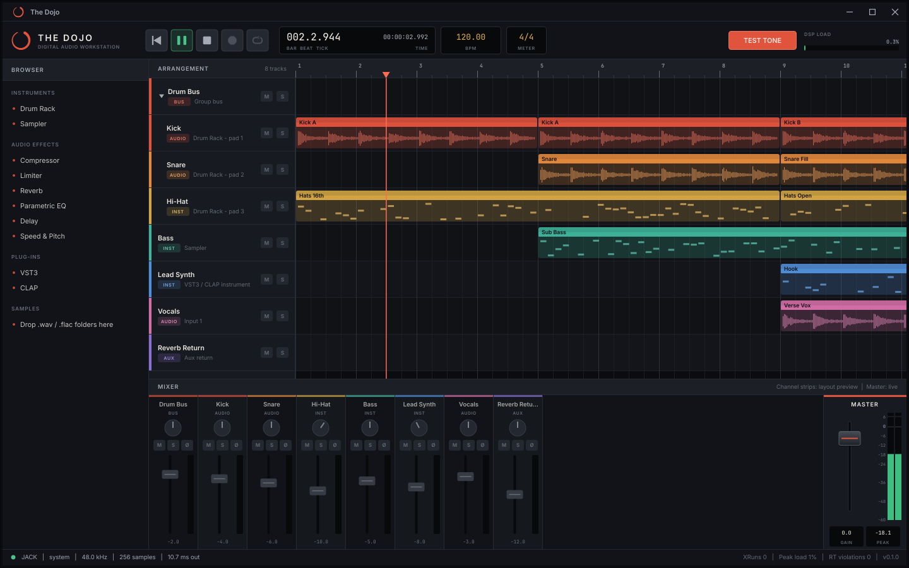

# The Dojo

A cross-platform digital audio workstation for **Windows and Linux**, with identical features on both. It is built in C++20 on JUCE, with a 64-bit floating-point mix engine and strictly real-time-safe audio code.

> **Status: Phase 1 (foundation).** The app opens a dark-mode main window, drives a real audio device, and runs a lock-free UI ↔ audio protocol. The arranger and mixer show a *layout preview*. Editing, recording, plug-ins and the rest arrive in later phases (see the [roadmap](#roadmap)).



*Live in Phase 1: transport and position display, playhead (click the ruler to locate), test tone, master fader and meter, DSP load, device status. The tracks, clips and channel strips are a static layout preview.*

## Tech stack

| | |
|---|---|
| Language | C++20 (GCC ≥ 11, Clang ≥ 14, MSVC 2022+) |
| Build | CMake ≥ 3.22 with presets, Ninja (Linux) / Visual Studio (Windows) |
| Audio, MIDI, plug-in hosting, GUI | [JUCE 9.0.4](https://github.com/juce-framework/JUCE), fetched and pinned automatically |
| Audio back-ends | Windows: ASIO, WASAPI, DirectSound. Linux: ALSA (incl. PulseAudio/PipeWire via ALSA), JACK (incl. PipeWire-JACK) |
| Tests | Catch2 v3 |

See [docs/ARCHITECTURE.md](docs/ARCHITECTURE.md) for the reasoning, the threading model and the real-time rules.

## Building

### Linux

```bash
sudo ./scripts/setup-linux.sh
```

```bash
./scripts/build.sh            # Release; add `debug`, `--clang`, `--run`, `--no-tests`
```

The binary is at `build/linux-release/src/app/TheDojo_artefacts/Release/TheDojo`.

### Windows

Install Visual Studio 2022 or newer with the **Desktop development with C++** workload, which includes CMake, and Git. Then, from PowerShell:

```powershell
.\scripts\build.ps1           # Release; add -Config Debug, -Run, -NoTests
```

The binary is at `build\windows-msvc\src\app\TheDojo_artefacts\Release\TheDojo.exe`.

### Plain CMake

```bash
cmake --preset linux-release
```

```bash
cmake --build --preset linux-release
```

```bash
ctest --preset linux-release
```

Run `cmake --list-presets` for all configurations, including `linux-asan`, `linux-tsan` and `windows-msvc`. To build offline against an existing JUCE checkout, add `-DFETCHCONTENT_SOURCE_DIR_JUCE=/path/to/JUCE`.

Sanitizer presets need Clang's runtimes (`libclang-rt-<ver>-dev` on Debian/Ubuntu). On recent kernels, run TSan binaries under `setarch $(uname -m) -R` to avoid its high-entropy-ASLR start-up failure. ASan and TSan replace `operator new`/`delete` themselves, so those builds omit the real-time allocation trap, and the three trap tests report SKIPPED.

## Running

| Option | Effect |
|---|---|
| `--audio-api=<name>` | Prefer a back-end: `JACK`, `ALSA`, `ASIO`, `Windows Audio`, `DirectSound` |
| `--test-tone` | Start with the 440 Hz / −18 dBFS diagnostic tone on |
| `--smoke-test[=secs]` | Self-check (UI renders, audio callback runs, zero RT violations), then exit 0/1 |
| `--version` | Print the version |

Keyboard: **Space** toggles play/pause, **Home** or **Enter** returns to the start. Click or drag in the ruler to move the playhead.

The log file is written to `~/.config/TheDojo/TheDojo.log` on Linux and `%APPDATA%\TheDojo\TheDojo.log` on Windows.

## Repository layout

```
cmake/       build options, compiler policy, pinned dependencies
docs/        architecture
resources/   embedded fonts
scripts/     setup and build helpers (bash + PowerShell)
src/core     real-time primitives (lock-free SPSC queue, RT allocation trap), musical time
src/engine   AudioEngine (audio thread), command/telemetry protocol, device host
src/ui       look-and-feel, panels
src/app      application entry point, main window
tests/       unit tests
```

## Roadmap

1. **Foundation**: stack, build system, dark-mode shell, UI/audio thread entry points, lock-free protocol *(this phase)*
2. **Audio & MIDI I/O**: device/driver selection and settings, input routing, MIDI hot-plug, latency compensation groundwork
3. Arranger and mixer: tracks, busses, folders, routing, clip editing, multi-core graph
4. MIDI sequencing: piano roll, quantise, CC lanes, step sequencer
5. Native DSP: compressor, limiter, reverb, parametric EQ, delay, speed and pitch
6. Instruments: Drum Rack, Sampler
7. Automation and export: spline lanes, offline/real-time bounce, WAV/FLAC/MP3, stems
8. Plug-in hosting: VST3 + CLAP, out-of-process scanning

## Licensing

No licence has been chosen for The Dojo yet. Note that JUCE is AGPLv3 or commercial, and the bundled ASIO SDK is GPLv3 or a Steinberg licence. See [docs/ARCHITECTURE.md](docs/ARCHITECTURE.md#10-licensing-note). The embedded Inter and JetBrains Mono fonts are under the SIL Open Font License; see `resources/fonts/`.
