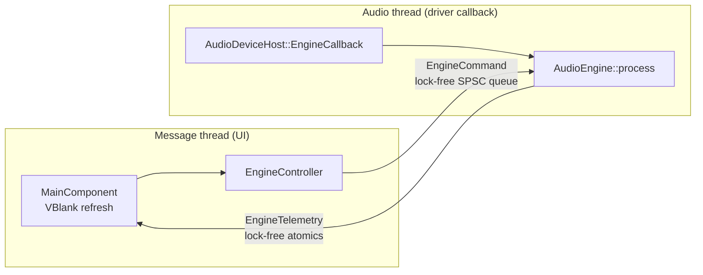

# The Dojo: architecture

This document describes how The Dojo is built: the layers, the threads, the real-time rules, the signal path and the document model.

## 1. Stack

| Concern | Choice | Why |
|---|---|---|
| Language | **C++20** | Deterministic, GC-free execution with direct control over memory and threads. It is the native language of every plug-in SDK (VST3, CLAP) and audio driver API (ASIO, WASAPI, ALSA, JACK). |
| Build | **CMake ≥ 3.22 + Ninja / Visual Studio**, `CMakePresets.json`, `FetchContent` | One build description for both OSes. Dependencies are pinned and fetched automatically, and presets give reproducible configurations for local builds and CI. |
| Audio I/O, MIDI, plug-in hosting, file formats, DSP | **JUCE 9.0.4** (`juce_audio_*`, `juce_dsp`) | A single API over ASIO / WASAPI / DirectSound and ALSA / JACK, plus hot-pluggable MIDI device I/O, VST3 hosting, WAV/FLAC/MP3 codecs and SIMD DSP building blocks. It's the industry-standard framework, with a decade of production use in commercial DAWs and plug-ins. |
| GUI | **JUCE `juce_gui_basics`**, custom look-and-feel | It draws every pixel itself, so the UI is identical on Windows (Direct2D) and Linux (X11). Fonts are embedded and the window chrome is drawn by JUCE, so even text metrics and title bars match. |
| CLAP hosting | Our own `juce::AudioPluginFormat` on the official `free-audio/clap` SDK (MIT, headers only) | JUCE hosts VST3 natively; CLAP plug-ins go through the same `AudioPluginFormatManager` / `AudioPluginInstance` interfaces, so the rest of The Dojo treats both alike. |
| Time-stretch / pitch-shift | Signalsmith Stretch (MIT, headers only) | High-quality, allocation-free processing after configuration; supports seeking, which clip playback needs after every locate. |
| MP3 encoding | LAME 3.100 (LGPL), vendored | JUCE reads MP3 but does not write it. |
| Tests | Catch2 v3 | The suite exercises the real engine headless, with the allocation trap armed. |

**Rejected alternatives.** Rust has excellent safety properties, but its plug-in *hosting* and GUI ecosystems (VST3/CLAP hosts, ASIO, a production-grade cross-platform widget toolkit) are still immature for a full DAW. Garbage-collected runtimes (C#, Java, Go, JS) are excluded by the real-time rules.

## 2. Source layout and layering

```
src/
  core/     pure C++20, no JUCE: lock-free SPSC queue, RT guards + allocation trap,
            musical-time maths, shared types, generated Version.h
  engine/   AudioEngine (real-time state, process(), offline render), WorkerPool, RenderGraph,
            command/telemetry protocol, ProcessorNode (runs any juce::AudioProcessor in the 64-bit
            path), Automation (monotone splines), RealtimeHandoff (ReleasePool, LiveMidiQueue,
            CaptureStream, DiskWriterThread), EngineController (the UI's facade),
            io/ (AudioDeviceHost: driver + MIDI binding, LameMp3Format),
            dsp/ (clip renderer, ClipStretcher, StreamedAudio, test tone)
  devices/  native devices as juce::AudioProcessors: EQ, Compressor, Limiter, Reverb, Delay,
            PitchShifter, Sampler, DrumRack; SampleSlot (RT-safe sample hand-over); registry
  plugins/  ClapPluginFormat (CLAP host), PluginManager (formats, known list, out-of-process scan)
  scanner/  dojo-plugin-scanner: opens one plug-in file and reports what it contains
  session/  the document: Session (juce::ValueTree + UndoManager), AudioAssetCache (decoding,
            peaks, disk streaming service), DeviceManager (live device instances), GraphCompiler
            (session -> RenderGraph), Recorder, Exporter, Project (file I/O)
  ui/       look-and-feel, MainComponent (commands, menus, document actions), arranger, mixer,
            devices panel + device editors, clip editor (piano roll, step sequencer, inspector),
            browser, transport, export dialog, EditorState (selection, grid, clipboard)
  app/      JUCEApplication (UI-thread entry), MainWindow, settings, CLI options, smoke test
resources/  embedded fonts (OFL)
tests/      Catch2 suite (plus a real CLAP binary built for the hosting tests)
third_party/lame  vendored MP3 encoder
cmake/      options, compiler policy, pinned dependencies
```

Each layer may depend only on the layers above it in this list (devices and plugins sit beside each other, below the engine). The UI never touches `AudioEngine` directly except for read-only status; it goes through `EngineController`.

JUCE's modules are compiled **once** into the `dojo::juce` static library, and the app, engine and tests all link that library.

## 3. Threads



| Thread | Entry point | Owner |
|---|---|---|
| Message / UI | `DojoApplication::initialise()` (via `START_JUCE_APPLICATION`) | JUCE |
| Audio | `AudioDeviceHost::EngineCallback::audioDeviceIOCallbackWithContext()` → `AudioEngine::process()` | The audio driver (ASIO / WASAPI / ALSA / JACK). JUCE raises it to real-time priority (MMCSS "Pro Audio" on Windows, `SCHED_FIFO` on Linux when permitted). |
| Engine workers | `WorkerPool`: up to 7 real-time threads (CPU count − 1) | Engine. Each block, the tracks of one dependency level are claimed by the audio thread and the workers through one atomic job word (CAS); workers are woken by a semaphore and the audio thread joins by spinning. Workers run inside `ScopedRealtimeSection` like the audio thread. |
| MIDI input | Driver threads | `AudioDeviceHost`'s MIDI callback pushes into `LiveMidiQueue` (producer side serialised by a mutex the audio thread never touches). |
| Audio decoding (2 threads) | `AudioAssetCache` job pool | Session. Decodes imported files and computes waveform peaks off the UI thread. |
| Disk streaming | `AudioAssetCache::StreamService` | Session. Keeps the chunks of long files around what is being played resident (read-ahead), evicts the rest; freed only after the engine has completed two more blocks. |
| Disk writing | `DiskWriterThread` | Recorder / real-time exports. Drains lock-free capture streams to WAV/FLAC/MP3 files. |
| Offline export | `Exporter` thread | Session. Owns the engine while live processing is paused, renders faster than real time. |
| Plug-in scanning | `PluginManager` thread + one `dojo-plugin-scanner` child process per file | A plug-in that crashes or hangs while being scanned only kills the child and gets blacklisted. |
| Browser scanning | `juce::TimeSliceThread` | UI. Lists folders for the file browser. |

## 4. Real-time rules and how they are enforced

Code reachable from `AudioEngine::process()` must never:

* allocate or free heap memory,
* take a lock, wait on a condition, sleep or do I/O,
* call into the UI, log, or throw.

How the rules are enforced:

| Mechanism | What it does |
|---|---|
| `dojo::rt::ScopedRealtimeSection` + allocation trap (`src/core/rt/AllocationTrap.cpp`) | Replaces global `operator new`/`delete`. Any heap traffic on a thread inside a real-time section is counted. The count is shown in the status bar of non-Release builds, and the suite asserts it stays at zero across ~10 s of randomised rendering. ASan/TSan builds omit the trap, because their runtimes own the allocator. |
| `rt::SpscQueue<T>` | Bounded, wait-free, cache-line-padded ring buffer. `T` must be trivially copyable, so copying an element can't allocate, lock or throw. Its memory ordering is verified by a 2-million-element cross-thread test under ThreadSanitizer (`linux-tsan` preset). |
| `EngineCommand` is a `std::variant` of trivially-copyable structs | A `static_assert` keeps it that way. |
| `rt::ThreadOwnershipChecker` | Asserts that the single-producer queue is only fed from one thread. |
| `juce::ScopedNoDenormals` | FTZ/DAZ for the duration of the callback. |
| Sub-block rendering | Drivers that over-deliver frames can never overrun pre-allocated buffers. |
| `--smoke-test` in CI | Launches the real app on both OSes and fails on any RT violation. |
| Hand-over patterns | `RenderGraph` swap with a return queue; `ReleasePool` (epoch-deferred frees); `SampleSlot` (acknowledged pointer swap for instrument samples); `CaptureStream` (wait-free ring, polled by a disk thread, no wake-up syscall); offline render hand-over (sequentially consistent flags, no waiting on the audio thread). |

**One caveat, stated plainly.** JUCE's driver layer (and essentially every driver abstraction, PortAudio and RtAudio included) brackets each callback with a mutex. That mutex is only ever contended while a device starts or stops, and no audio is being rendered then. In steady state it is an uncontended user-space atomic: no syscall, no blocking. The Dojo's own code takes no locks on the audio thread at all.

## 5. UI → audio: commands

```
UI widget -> EngineController::play()/setMasterGainDecibels()/...
          -> EngineCommand (trivially copyable)
          -> AudioEngine::post()  [wait-free push]
          -> drained at the start of the next audio block
```

The queue is bounded, so pushes can fail. The only realistic case is when no device is running and nothing drains the queue. In that case `EngineController` parks commands in a message-thread outbox and retries them in FIFO order on a timer. Consecutive *coalescable* commands are merged there. These are absolute setters such as gain, where only the newest value matters. Nothing is silently dropped.

**Large objects: the render graph.** What the audio thread plays is an immutable `RenderGraph`: tracks in dependency order and grouped into *levels*, with their kind (audio / instrument / bus), mix settings and automation curves, clips (pointers into decoded or streamed audio, plus clip stretchers), MIDI clips, device chains (`ProcessorNode`s), bus sources, sends, aux returns, sidechains and compensation delays. Everything it points to is kept alive by `shared_ptr`s owned by the graph.

1. **Build.** Every session edit, coalesced per message-loop iteration, makes `GraphCompiler` build a fresh graph on the message thread.
2. **Hand over.** `EngineController::publishGraph()` posts it to the audio thread by pointer (`command::SwapGraph`), with at most one graph in flight; newer graphs replace the pending one.
3. **Swap and return.** The audio thread swaps the pointer and pushes the old graph onto a lock-free *return queue*.
4. **Destroy.** `EngineController` destroys returned graphs on its housekeeping timer.

So the audio thread never allocates or frees, even though the document changes freely. Per-track state that must outlive a swap (gain smoothing, meters) lives in fixed engine arrays indexed by a stable *slot* that the compiler assigns to each track. The test suite asserts zero heap activity on the audio thread while graphs are swapped during playback.

**Sample-rate independence.** Clip positions are in seconds. The engine converts them per block and resamples sources whose rate differs from the device's (4-point Hermite). Changing the device rate therefore needs no rebuild, and the playhead keeps its time position across rate changes.

## 6. Audio → UI: telemetry

Continuous status (peak levels, DSP load, playhead, transport state) is published through individual lock-free atomics in `EngineTelemetry`. A queue would be the wrong tool here: only the latest value matters.

Peak values are "max since last read". The audio thread raises them with a CAS max and the UI collects and resets them with `exchange(0)` once per frame, so a one-sample transient can't fall between two UI frames.

The UI **pulls** telemetry from a `juce::VBlankAttachment` callback once per display refresh. The audio thread never calls into the UI.

## 7. Signal path and precision

The internal mix runs in `double` (`dojo::Sample`). Conversion to and from the driver's `float` happens once, at the device edge. Devices that support 64-bit processing (all native devices) run in place; 32-bit plug-ins go through a pre-allocated scratch buffer.

```
for each dependency level (in parallel across the worker pool):
    source:  audio clips (resampled / time-stretched / streamed, faded, crossfaded) + monitored input
           | MIDI clips + live MIDI -> instrument
           | bus: sum of routed tracks, folder children, sends, an instrument's aux outputs
    -> device chain (sidechains from earlier levels) -> pre-fader copy (for pre-fader sends)
    -> smoothed volume / pan (automation), mute/solo, phase -> meter -> delay compensation
master: sum of tracks routed to it -> master devices -> master gain (automation) -> meter -> out
```

- **Routing.** A track feeds its output bus, else its folder, else the master. Busses pull their inputs (so parallel tracks never write to shared buffers). The compiler refuses any edge (output, send, aux return, sidechain) that would close a loop.
- **Delay compensation.** Each track's output latency is computed from its devices and inputs; every source is delayed (per-slot ring buffer, up to 8192 samples) to match the latest path into the same destination, iterated to a fixed point. Exports skip the total latency so files line up with the timeline.
- **MIDI.** Notes are rendered sample-accurately per block (note-offs first); stop, locate and loop wraps send all-notes-off.
- **Loop and varispeed.** Loop wraps split a block at the exact sample. The timeline advances `speed / sampleRate` seconds per sample; with *keep pitch* the clips are transposed back through their stretchers.
- **Pan law:** balance. At centre both sides are at unity, and panning attenuates the opposite side linearly.
- **Clip edges:** every edge gets at least a 1 ms fade; user fades are linear, crossfades equal power.

## 8. The document (session layer)

The session is a `juce::ValueTree` with a `juce::UndoManager`:

```
DOJO_SESSION  tempo, loop, speed, keep pitch, transpose, master volume
  MASTER        DEVICE*, AUTOMATION*
  TRACK*        kind (audio | instrument | bus), folder, mix, routing, input, monitor, arm, speed, pitch
    CLIP*         audio: file, position, offset, fades, gain, stretch, pitch
    MIDICLIP*     position, content offset (beats); NOTE* and CC* children
    DEVICE*       type (native or "plugin" + PluginDescription), bypass, sidechain, saved state
    SEND*         target bus, level, pre/post
    AUTOMATION*   target (volume, pan, send:<id>, param:<device>:<index>); POINT* children
    TRACK*        (folders contain tracks)
```

- **Undo.** Every UI gesture opens one transaction, so a fader drag, a clip move or a recording is one undo step. Removing a device stores its latest state in the detached tree, so undo restores it exactly.
- **Change tracking.** Components observe the tree. Those listeners also drive graph compilation, the unsaved-changes flag and the window title.
- **Devices.** `DeviceManager` owns the live processor behind every DEVICE (created on demand, restored from its saved state, prepared at the device's rate). Parameter changes made in device editors or plug-in windows mark the project as changed; states are written into the tree on save.
- **Files.** A session is saved as XML (`.dojo`, format version 2; version 1 files still load). Clip paths are stored both absolute and relative to the session file, and the relative path wins on load.
- **Audio.** `AudioAssetCache` decodes files up to 10 minutes into memory and streams longer ones from disk, with a min/max peak overview for drawing either way.

## 9. Start-up and shutdown order

```
initialise: logger -> look-and-feel -> settings -> AudioEngine -> AudioDeviceHost (opens the saved or
            default device, enables MIDI inputs; audio starts) -> EngineController -> PluginManager
            -> Project (devices, compiler) -> Recorder, Exporter -> MainWindow
shutdown:   MainWindow -> Exporter, Recorder -> AudioDeviceHost (device stopped; no callback in
            flight) -> Project -> PluginManager -> EngineController -> AudioEngine (frees the last
            graphs and their devices) -> settings -> look-and-feel -> logger
```

## 10. Windows / Linux parity policy

* **One code path.** Platform differences live only inside JUCE and the build scripts.
* **Plug-in formats: VST3 and CLAP only.** Both exist on both OSes. LV2, LADSPA and AU are deliberately disabled because they would create features that only one OS has.
* **Audio back-ends** are platform-native, with feature-equivalent capabilities. Windows: ASIO, WASAPI (shared/exclusive), DirectSound. Linux: ALSA, JACK. PulseAudio and PipeWire are reached through their ALSA PCM plug-ins and PipeWire's JACK implementation.
* **Visual parity:** embedded Inter and JetBrains Mono fonts, plus JUCE-drawn window chrome.
* **Vendored code** (JUCE and the codecs it bundles) is compiled without warnings. Dojo's own targets use JUCE's strict warning set, and CI treats those warnings as errors.
* **CI** builds, tests and smoke-runs the real app on Ubuntu (GCC and Clang) and Windows (MSVC) for every pull request.

## 11. Licensing note

JUCE 9 is dual-licensed: AGPLv3 or a commercial JUCE licence. The bundled ASIO SDK is GPLv3 or a Steinberg licence. Distributing The Dojo as closed source therefore requires a commercial JUCE licence and a Steinberg ASIO licence. Distributing it as open source requires an AGPLv3-compatible licence. LAME is LGPL 2.0 or later and is linked statically, so a binary distribution must let users relink against a modified LAME (or ship it as a shared library). The CLAP SDK and Signalsmith Stretch are MIT. The embedded fonts are SIL OFL 1.1.
