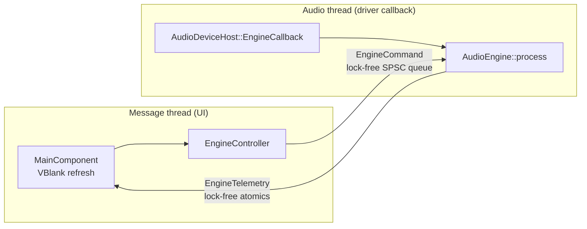

# The Dojo: architecture

This document describes how The Dojo is built: the layers, the threads, the real-time rules, the signal path and the document model.

## 1. Stack

| Concern | Choice | Why |
|---|---|---|
| Language | **C++20** | Deterministic, GC-free execution with direct control over memory and threads. It is the native language of every plug-in SDK (VST3, CLAP) and audio driver API (ASIO, WASAPI, ALSA, JACK). |
| Build | **CMake ≥ 3.22 + Ninja / Visual Studio**, `CMakePresets.json`, `FetchContent` | One build description for both OSes. Dependencies are pinned and fetched automatically, and presets give reproducible configurations for local builds and CI. |
| Audio I/O, MIDI, plug-in hosting, file formats, DSP | **JUCE 9.0.4** (`juce_audio_*`, `juce_dsp`) | A single API over ASIO / WASAPI / DirectSound and ALSA / JACK, plus hot-pluggable MIDI device I/O, VST3 hosting, WAV/FLAC/MP3 codecs and SIMD DSP building blocks. It's the industry-standard framework, with a decade of production use in commercial DAWs and plug-ins. |
| GUI | **JUCE `juce_gui_basics`**, custom look-and-feel | It draws every pixel itself, so the UI is identical on Windows (Direct2D) and Linux (X11). Fonts are embedded and the window chrome is drawn by JUCE, so even text metrics and title bars match. |
| CLAP hosting | Our own `juce::AudioPluginFormat` on the official `free-audio/clap` SDK (MIT, headers only) | JUCE hosts VST3 natively; CLAP plug-ins go through the same `AudioPluginFormatManager` / `AudioPluginInstance` interfaces, so the rest of The Dojo treats both alike. |
| Time-stretch / pitch-shift | Signalsmith Stretch (MIT, headers only) | High-quality, allocation-free processing after configuration; supports seeking, which clip playback needs after every locate. |
| MP3 encoding | LAME 3.100 (LGPL), vendored | JUCE reads MP3 but does not write it. |
| Tests | Catch2 v3 | The suite exercises the real engine headless, with the allocation trap armed. |

**Rejected alternatives.** Rust has excellent safety properties, but its plug-in *hosting* and GUI ecosystems (VST3/CLAP hosts, ASIO, a production-grade cross-platform widget toolkit) are still immature for a full DAW. Garbage-collected runtimes (C#, Java, Go, JS) are excluded by the real-time rules.

## 2. Source layout and layering

```
src/
  core/     pure C++20, no JUCE: lock-free SPSC queue, RT guards + allocation trap,
            musical-time maths, shared types, generated Version.h, HardwareIo (devices that
            use the sound card's channels themselves), WarpMap (clip time <-> source time)
  engine/   AudioEngine (real-time state, process(), offline render), WorkerPool, RenderGraph,
            command/telemetry protocol, ProcessorNode (runs any juce::AudioProcessor in the 64-bit
            path), Automation (monotone splines), RealtimeHandoff (ReleasePool, LiveMidiQueue,
            CaptureStream, DiskWriterThread), TrackTaps (watched tracks' sound for displays),
            EngineController (the UI's facade),
            io/ (AudioDeviceHost: driver + MIDI binding, LameMp3Format),
            Preview (browser file preview: decoder thread + PreviewPlayer on the audio thread),
            dsp/ (clip renderer, ClipStretcher, StreamedAudio, test tone)
  devices/  native devices as juce::AudioProcessors: EQ, Compressor, Limiter, Reverb, Delay, Echo,
            Utility, AmpCabinet, PitchShifter; instruments WavetableSynth, Operator, Sampler,
            DrumRack, Impulse; MIDI effects (MidiEffects: Arpeggiator, Chord Generator, Scale,
            MIDI Filter); HardwareInsert (outboard gear through the sound card, ping calibration);
            dsp/ (biquads, SynthCore: envelopes, ZDF filters, LFOs,
            band-limited mipmapped wavetables); SampleSlot (RT-safe sample hand-over); registry
  plugins/  ClapPluginFormat (CLAP host), PluginManager (formats, known list, out-of-process scan)
  scanner/  dojo-plugin-scanner: opens one plug-in file and reports what it contains
  session/  the document: Session (juce::ValueTree + UndoManager; Takes.cpp: take lanes and
            comping), AudioAssetCache (decoding, peaks, disk streaming service), DeviceManager (live
            device instances), GraphCompiler (session -> RenderGraph), Recorder (takes, loop
            recording), Exporter, Project (file I/O)
  ui/       look-and-feel and themes (theme/: a palette the active theme writes; switching rebuilds
            the main component, keeping the view), Preferences + PreferencesWindow,
            MainComponent (commands, menus, document actions), arranger, mixer,
            devices panel + device editors (hardware replicas draw their machine with
            HardwarePainting: meters, lamps, wood, leather, faders; consoles set a
            ConsoleLookAndFeel on their editor; SpectrumAnalysis: the EQ's spectra and masking),
            surfaces/ (Mackie Control and HUI protocols, ControlSurfaces, DevicePorts),
            clip editor (piano roll, step sequencer, inspector),
            browser (devices/plug-ins and user folders, search, preview; BrowserDrag carries file
            paths to any drop target), transport, export dialog, EditorState (selection, grid, clipboard)
  app/      JUCEApplication (UI-thread entry), MainWindow, settings, CLI options, smoke test
resources/  embedded fonts (OFL)
tests/      Catch2 suite (plus a real CLAP binary built for the hosting tests)
third_party/lame  vendored MP3 encoder
cmake/      options, compiler policy, pinned dependencies
```

Each layer may depend only on the layers above it in this list (devices and plugins sit beside each other, below the engine). The UI never touches `AudioEngine` directly except for read-only status; it goes through `EngineController`.

JUCE's modules are compiled **once** into the `dojo::juce` static library, and the app, engine and tests all link that library.

## 3. Threads



| Thread | Entry point | Owner |
|---|---|---|
| Message / UI | `DojoApplication::initialise()` (via `START_JUCE_APPLICATION`) | JUCE |
| Audio | `AudioDeviceHost::EngineCallback::audioDeviceIOCallbackWithContext()` → `AudioEngine::process()` | The audio driver (ASIO / WASAPI / ALSA / JACK). JUCE raises it to real-time priority (MMCSS "Pro Audio" on Windows, `SCHED_FIFO` on Linux when permitted). |
| Engine workers | `WorkerPool`: up to 7 real-time threads (CPU count − 1) | Engine. Each block, the tracks of one dependency level are claimed by the audio thread and the workers through one atomic job word (CAS); workers are woken by a semaphore and the audio thread joins by spinning. Workers run inside `ScopedRealtimeSection` like the audio thread. |
| MIDI input | Driver threads | `AudioDeviceHost`'s MIDI callback pushes into `LiveMidiQueue` (producer side serialised by a mutex the audio thread never touches). |
| Audio decoding (2 threads) | `AudioAssetCache` job pool | Session. Decodes imported files and computes waveform peaks off the UI thread. |
| Disk streaming | `AudioAssetCache::StreamService` | Session. Keeps the chunks of long files around what is being played resident (read-ahead), evicts the rest; freed only after the engine has completed two more blocks. |
| Disk writing | `DiskWriterThread` | Recorder / real-time exports. Drains lock-free capture streams to WAV/FLAC/MP3 files. |
| Offline export | `Exporter` thread | Session. Owns the engine while live processing is paused, renders faster than real time. |
| Plug-in scanning | `PluginManager` thread + one `dojo-plugin-scanner` child process per file | A plug-in that crashes or hangs while being scanned only kills the child and gets blacklisted. |
| Browser search | `BrowserPanel::SearchThread` | UI. Searches the added folders recursively; results are posted back to the message thread. |
| Preview decoding | `PreviewService` thread | Engine. Decodes and resamples a previewed file into a buffer allocated up front, publishing how far it got (`framesReady`, release/acquire) so playback starts before decoding ends. The audio thread adds the sound to the device output after the mix (never metered, recorded or exported); sounds are handed over and retired like `SampleSlot`. |

## 4. Real-time rules and how they are enforced

Code reachable from `AudioEngine::process()` must never:

* allocate or free heap memory,
* take a lock, wait on a condition, sleep or do I/O,
* call into the UI, log, or throw.

How the rules are enforced:

| Mechanism | What it does |
|---|---|
| `dojo::rt::ScopedRealtimeSection` + allocation trap (`src/core/rt/AllocationTrap.cpp`) | Replaces global `operator new`/`delete`. Any heap traffic on a thread inside a real-time section is counted. The count is shown in the status bar of non-Release builds, and the suite asserts it stays at zero across ~10 s of randomised rendering. ASan/TSan builds omit the trap, because their runtimes own the allocator. |
| `rt::SpscQueue<T>` | Bounded, wait-free, cache-line-padded ring buffer. `T` must be trivially copyable, so copying an element can't allocate, lock or throw. Its memory ordering is verified by a 2-million-element cross-thread test under ThreadSanitizer (`linux-tsan` preset). |
| `EngineCommand` is a `std::variant` of trivially-copyable structs | A `static_assert` keeps it that way. |
| `rt::ThreadOwnershipChecker` | Asserts that the single-producer queue is only fed from one thread. |
| `juce::ScopedNoDenormals` | FTZ/DAZ for the duration of the callback. |
| Sub-block rendering | Drivers that over-deliver frames can never overrun pre-allocated buffers. |
| `--smoke-test` in CI | Launches the real app on both OSes and fails on any RT violation. |
| Hand-over patterns | `RenderGraph` swap with a return queue; `ReleasePool` (epoch-deferred frees); `SampleSlot` (acknowledged pointer swap for instrument samples); `CaptureStream` (wait-free ring, polled by a disk thread, no wake-up syscall); offline render hand-over (sequentially consistent flags, no waiting on the audio thread). |

**One caveat, stated plainly.** JUCE's driver layer (and essentially every driver abstraction, PortAudio and RtAudio included) brackets each callback with a mutex. That mutex is only ever contended while a device starts or stops, and no audio is being rendered then. In steady state it is an uncontended user-space atomic: no syscall, no blocking. The Dojo's own code takes no locks on the audio thread at all.

## 5. UI → audio: commands

```
UI widget -> EngineController::play()/setMasterGainDecibels()/...
          -> EngineCommand (trivially copyable)
          -> AudioEngine::post()  [wait-free push]
          -> drained at the start of the next audio block
```

The queue is bounded, so pushes can fail. The only realistic case is when no device is running and nothing drains the queue. In that case `EngineController` parks commands in a message-thread outbox and retries them in FIFO order on a timer. Consecutive *coalescable* commands are merged there. These are absolute setters such as gain, where only the newest value matters. Nothing is silently dropped.

**Large objects: the render graph.** What the audio thread plays is an immutable `RenderGraph`: tracks in dependency order and grouped into *levels*, with their kind (audio / instrument / bus), mix settings and automation curves, clips (pointers into decoded or streamed audio, plus clip stretchers), MIDI clips, device chains (`ProcessorNode`s), bus sources, sends, aux returns, sidechains and compensation delays. Everything it points to is kept alive by `shared_ptr`s owned by the graph.

1. **Build.** Every session edit, coalesced per message-loop iteration, makes `GraphCompiler` build a fresh graph on the message thread.
2. **Hand over.** `EngineController::publishGraph()` posts it to the audio thread by pointer (`command::SwapGraph`), with at most one graph in flight; newer graphs replace the pending one.
3. **Swap and return.** The audio thread swaps the pointer and pushes the old graph onto a lock-free *return queue*.
4. **Destroy.** `EngineController` destroys returned graphs on its housekeeping timer.

So the audio thread never allocates or frees, even though the document changes freely. Per-track state that must outlive a swap (gain smoothing, meters) lives in fixed engine arrays indexed by a stable *slot* that the compiler assigns to each track. The test suite asserts zero heap activity on the audio thread while graphs are swapped during playback.

**Sample-rate independence.** Clip positions are in seconds. The engine converts them per block and resamples sources whose rate differs from the device's (4-point Hermite). Changing the device rate therefore needs no rebuild, and the playhead keeps its time position across rate changes.

## 6. Audio → UI: telemetry

Continuous status (peak levels, DSP load, playhead, transport state) is published through individual lock-free atomics in `EngineTelemetry`. A queue would be the wrong tool here: only the latest value matters.

Peak values are "max since last read". The audio thread raises them with a CAS max and the UI collects and resets them with `exchange(0)` once per frame, so a one-sample transient can't fall between two UI frames.

The UI **pulls** telemetry from a `juce::VBlankAttachment` callback once per display refresh. The audio thread never calls into the UI.

**Control surfaces.** `ui::surfaces` keeps the protocols apart from the session. `SurfaceProtocol` holds pure encoders and decoders for Mackie Control (stateless: pitch-bend faders, note keys, relative CCs, SysEx LCD and handshake) and HUI (a stateful decoder: a zone, then its port; a fader's high bits, then its low ones). `ControlSurfaces` (owned by the main window, so it outlives theme rebuilds of the main component) maps their events onto the session, the selection and the application's commands through a `Host` of callbacks. Thirty times a second it sends each unit only what changed since the last update (faders, LEDs, rings, LCD lines, meters, displays); a touched fader is never driven. MIDI reaches it through `Ports`. In the application, `AudioDeviceHost::routeMidiInput` diverts a surface's input, SysEx included, from the engine's live MIDI to a handler that queues it under a mutex. That is on a MIDI thread, never the audio thread, and the timer drains the queue on the message thread. Removing a route takes the same mutex, so no call is still running once it returns. Meters read `EngineTelemetry::surfacePeaks`, a second max-since-read accumulator per track, so the surfaces never steal the mixer's peaks.

**Track taps.** Displays that need a track's sound rather than a number (the EQ's spectrum overlays) watch it in `engine::TrackTaps`: 16 taps, each a track id and a ring of 8192 atomic floats with a write index. `watch()` and `unwatch()` are counted, so several EQs can follow one track; they run on the message thread, and claiming a tap publishes its id last with release order. The audio thread writes each watched track's post-fader output, summed to mono, after its fader and phase (`AudioEngine::processTrack`). When no tap is in use that is one atomic load per track; otherwise it is a compare per tap. The UI copies the newest samples at its own pace and runs the FFT itself (`ui::spectrum::Analyser`). Nothing is allocated or locked on the audio thread. The EQ's sidechain input is the other way to get a track's sound: the compiler routes the picked track to the device's second input bus, and the EQ keeps that bus's mono sum in its own analyser ring.

## 7. Signal path and precision

The internal mix runs in `double` (`dojo::Sample`). Conversion to and from the driver's `float` happens once, at the device edge. Devices that support 64-bit processing (all native devices) run in place; 32-bit plug-ins go through a pre-allocated scratch buffer.

```
for each dependency level (in parallel across the worker pool):
    source:  audio clips (resampled / time-stretched / streamed, faded, crossfaded) + monitored input
           | MIDI clips + live MIDI -> instrument
           | bus: sum of routed tracks, folder children, sends, an instrument's aux outputs
    -> device chain (sidechains from earlier levels) -> pre-fader copy (for pre-fader sends)
    -> smoothed volume / pan (automation), mute/solo, phase -> meter -> delay compensation
master: sum of tracks routed to it -> master devices -> master gain (automation) -> meter -> out
device out += browser preview (live callbacks only)
```

- **Insert loops.** A device whose processor implements `InsertLoopHost` (the Rhodes Suitcase) can hold devices of its own (DEVICE children of its DEVICE). When its loop is engaged and not empty, the compiler gives its `RenderDevice` a nested `loop` chain, and the engine runs the host in two halves around it: `processSend()` (up to the send; the buffer then holds the send), the loop's devices in order, then `processReturn()` (from the return to the output). A disengaged loop or a bypassed host runs the device in one piece. A loop can be in series (everything passes through it) or in parallel (the TG12345's echo send: the host mixes the return with its own signal, which it delays by the loop's latency, `RenderDevice::loopLatency`, passed to `processReturn()`). Loop devices count in their track's latency, automation lanes, sidechain dependencies and delay compensation; the loop switch reports a latency change, so the graph is recompiled when it flips.
- **MIDI effects.** A track's MIDI (its clips, live input, MIDI tracks playing it) is one buffer that runs through the device chain with the audio. Processors that accept MIDI get it and may rewrite it in place; the rest get an empty one. MIDI effects (`devices::MidiEffect`: Arpeggiator, Chord Generator, Scale, MIDI Filter) pass the audio through and rewrite the MIDI, so they sit before the instrument. `ProcessorNode::isInstrument()` excludes them, and the compiler records which device is the instrument (`RenderTrack::instrumentIndex`) for its aux outputs and their tap time. On a MIDI track the chain's MIDI is what its instrument track picks up. The UI keeps every chain in the order MIDI effects, instrument, audio effects (`deviceActions::canMoveDevice`, `insertionIndex`). MIDI effects write raw bytes into a pre-sized buffer and never allocate.
- **Warp markers.** A clip's warp map (`core/WarpMap.h`, pure and allocation-free) runs from its start (clip time 0 plays its source offset) through its markers (clip time, source time; both increasing) and continues past the last marker at the clip's stretch. Markers are stored on the CLIP tree relative to the clip's start, so moving one changes only the two stretches beside it. Trims, splits and Render Clip Gain shift or cut them so every moment of the source keeps its place. The compiler copies them into `RenderClip::warp` (scaled by the track's speed) and gives a warped clip the stretcher. `ClipStretcher` takes its source position from the map and seeks at the map's local rate, so it feeds varying amounts of source per block; Signalsmith Stretch follows the changing ratio. Segments are capped at 4x the source's speed, which keeps the stretcher's pre-sized input buffer large enough. Hitpoints come from the tempo detector's onset stages (`tempo::detectHitpoints`), run over the part of the file a clip plays, and are stored on the clip as source seconds.
- **Take lanes and comping.** A track's TAKELANE children hold takes: clips that never play. The track's own clips are the comp, so playback, export and editing need nothing new. Comp clips carry the id of the lane they came from (`take`), which drives the lanes' highlights. `Session::compTake` (session/Takes.cpp) swipes a stretch of a lane into the comp in three steps.
  - It first joins neighbouring comp clips that are untouched copies of the same take (same file and source timing, gain, no locks), so the take is cut again as one clip and their outer edits stay put. Repeated swipes therefore never drift.
  - It then plans each edit against the comp clip across it: a crossfade of the set length centred where both sides have material. The new piece is cut from the take with `splitClip`, so stretched, warped, looped and MIDI takes all cut correctly.
  - Overlapping clips get equal-power crossfades from the compiler (`applyCrossfades`). Where the same material goes on, the clips get linear fades of exactly the overlap, which the compiler keeps, so the crossfade is equal gain. Leftovers inside an earlier crossfade are removed.
  - A track's `audition` names a lane the compiler plays instead of the comp.
  - The Recorder puts takes in lanes when a take covers earlier material, the track has lanes, or a loop recording has several passes; loose comp material first goes into a lane of its own (`keepCompInTakeLane`).
  - Loop recording leaves the engine's loop running during the capture (`CaptureSession::suspendLoop` false). The engine counts the wraps (`loopPasses`) and stamps captured MIDI with them. The audio stays one continuous file: each pass is a window onto it at `firstWrap + (k - 1) * loop + latency`.
- **Hardware inserts.** A device implementing `HardwareIoDevice` (core/HardwareIo.h: the HW Insert) uses the sound card's channels itself. The node detects it (`ProcessorNode::getHardwareIo()`), and the compiler lists every such device in the graph (`RenderGraph::hardwareIo`, a chain's own instance only, never a surround companion). Before each sub-block's levels run, the engine hands each one the sound card's inputs for that sub-block (`HardwarePorts`: 64-bit `inputBus_` pointers, channel counts, buffer size, the driver's reported latency; `live` is false in offline renders). The device reads its return from them while it processes and keeps its send in a buffer of its own. After the master is written to the outputs, the engine has each one add its send to the sound card's outputs (`addSends`), so devices on parallel workers never write to shared memory. The ports hold for one sub-block only, so a device processed without them (an offline render, a companion) passes its signal through, delayed by its latency. The round trip is the device's latency, and delay compensation does the rest. The device measures it on the audio thread by sending a sweep and recording the return, and analyses it on the message thread in `service()` (called by the DeviceManager's timer under its lock, so never while devices are re-prepared). `AudioDeviceHost` passes the driver's input and output latency to the engine (`setDeviceLatency`) as the figure used until a measurement exists.
- **Device sends.** A SEND with a `sourceDevice` (and `sourceLeft` / `sourceRight`) takes two of that device's extra (aux) outputs instead of the track's output: a console channel's bus assignments, aux and cue sends. The compiler finds the device's node in the source track's chain; its tap time is the latency of the chain up to and including that device, so the bus's delay compensation aligns it like any other input. The engine reads the node's aux buffers (filled when the source track ran, an earlier level) and skips them while the source is muted or soloed away.
- **Channels and slot room.** A signal carries up to 16 channels (`kMaxChannels`, a 9.1.6 bed), one per speaker of its `ChannelLayout`; layouts convert by speaker (`conversionMatrix`: heights fold into the ear-level speaker below at -3 dB, wides into front and surround). A track's slot holds its own channels and its destination's (its fader converts: the surround panner or the conversion), so a stereo track feeding a 7.1.4 master works in 12 channels. Slots start with two channels and an 8192-sample delay ring. When the compiler finds a track needing more (`RenderTrack::bufferChannels`; a bus also counts its sends' channels), it allocates `SlotBuffers` on the message thread (channels, and a delay ring a power of two at least the track's compensation delay, from 1024) and hands them over in the graph. The engine `std::swap`s them into the slot when it applies the graph (moves, no allocation), and the old buffers stay in the graph, freed with it on the message thread. Slots never shrink; `prepare()` keeps each slot's room at the new block size. The compiler tracks what each slot was given (`GraphBuilder::room_`, reset by `setRenderFormat`). A graph that replaces one never posted inherits that graph's room (`EngineController::publishGraph`), so no promised room is lost. A track whose slot lacks room is silent rather than wrong (`processTrack`).
- **Offline renders are not monitoring.** While an offline render is active (`offlineActive_`), the output stage writes a surround master's channels to their own outputs, or the ITU fold-down into fewer, whatever the surround monitoring mode (virtualizer, device order) says.
- **Routing.** A track feeds its output bus, else its folder, else the master. Busses pull their inputs (so parallel tracks never write to shared buffers). The compiler refuses any edge (output, send, aux return, sidechain) that would close a loop.
- **Delay compensation.** Each track's output latency is computed from its devices and inputs; every source is delayed (per-slot ring buffer, up to 8192 samples) to match the latest path into the same destination, iterated to a fixed point. Exports skip the total latency so files line up with the timeline.
- **MIDI.** Notes are rendered sample-accurately per block (note-offs first); stop, locate and loop wraps send all-notes-off.
- **Per-note expression (MPE).** A NOTE may carry pitch (semitones, ±48), pressure and slide (0..1) curves, stored as `"beat:value;..."` from the note's start (`note::getExpression` / `setExpression`; `thinExpression` drops points a straight line passes within a tolerance of, keeping jumps). A MIDI clip with any expression compiles as MPE (`RenderMidiClip::mpe`): the compiler gives each note a member channel (2..16, the least recently started of the free channels, else the one freed soonest) and copies the curves into one pool (`RenderMidiClip::expression`, each note keeping first/count per kind). The engine is stateless per block, as for notes. Before a note-on it sends the note's channel its starting bend, channel pressure and CC 74, then polyphonic aftertouch after it. While the note sounds it samples the curves on a grid of 128 samples aligned to the timeline, and sends a message only where the quantised value differs from the grid point before. So a flat curve sends nothing, and the output does not depend on how the blocks fall. Blocks over 1024 samples use a coarser grid (8 points a block), which bounds what the pre-sized MIDI buffer must hold. The member bend range is 48 semitones (`kMpePitchBendRange`), the MPE default and Drift's and Meld's. Controller 129 (CC lanes) is channel pressure.
  - Recording (the Recorder, with MPE input on): pitch bend, channel pressure and CC 74 on a member channel holding exactly one note go to that note's curves (scaled by the controller's bend range from the preferences). Sent while the channel holds no note, they are its next note's starting values. A value that arrives after a gap of more than 20 ms becomes a step: the previous value is held until it. Channel 1, chords on one channel, and MPE input off record controllers. Polyphonic aftertouch is always its note's pressure. The curves are thinned before they are stored.
- **Loop and varispeed.** Loop wraps split a block at the exact sample. The timeline advances `speed / sampleRate` seconds per sample; with *keep pitch* the clips are transposed back through their stretchers.
- **Pan law:** balance. At centre both sides are at unity, and panning attenuates the opposite side linearly.
- **Clip edges:** every edge gets at least a 1 ms fade; user fades are linear, crossfades equal power.

## 8. The document (session layer)

The session is a `juce::ValueTree` with a `juce::UndoManager`:

```
DOJO_SESSION  tempo, loop, speed, keep pitch, transpose, master volume
  MASTER        DEVICE*, AUTOMATION*
  TRACK*        kind (audio | instrument | bus), folder, mix, routing, input, monitor, arm, speed, pitch,
                format (mono, stereo, 3.1, 5.1, 7.1, 5.1.4, 7.1.4, 9.1.6, Dolby Digital, DTS; the master too)
    CLIP*         audio: file, position, offset, fades, gain, stretch, pitch
    MIDICLIP*     position, content offset (beats); NOTE* (with per-note pitch / pressure / slide curves) and CC* children
    DEVICE*       type (native or "plugin" + PluginDescription), bypass, sidechain, saved state
      DEVICE*       (an insert loop's devices, in order; their lanes live on the track)
    SEND*         target bus, level, pre/post (or a device's outputs: sourceDevice, sourceLeft, sourceRight)
    AUTOMATION*   target (volume, pan, send:<id>, param:<device>:<index>); POINT* children
    TAKELANE*     name; CLIP* / MIDICLIP* (takes: they do not play; the comp is the track's clips)
    TRACK*        (folders contain tracks)
```

- **Undo.** Every UI gesture opens one transaction, so a fader drag, a clip move or a recording is one undo step. Removing a device stores its latest state in the detached tree, so undo restores it exactly.
- **Change tracking.** Components observe the tree. Those listeners also drive graph compilation, the unsaved-changes flag and the window title.
- **Devices.** `DeviceManager` owns the live processor behind every DEVICE (created on demand, restored from its saved state, prepared at the device's rate). Parameter changes made in device editors or plug-in windows mark the project as changed; states are written into the tree on save.
- **Content length.** `Session::getContentEnd(owner)` says how far an owner's material runs: the whole arrangement for the master, a track's last clip end, or for a bus or folder the latest end of whatever feeds it (routing, membership, sends, MIDI, aux sources, recursively; inactive tracks feed nothing). The tape machine's deck sizes its reels with it. Devices read the transport's time from the play head on the audio thread and publish it in an atomic (`TapeA800::getTapeSeconds`); the deck reads that and never touches the play head itself.
- **Files.** A session is saved as XML (`.dojo`, format version 2; version 1 files still load). Clip paths are stored both absolute and relative to the session file, and the relative path wins on load.
- **Audio.** `AudioAssetCache` decodes files up to 10 minutes into memory and streams longer ones from disk, with a min/max peak overview for drawing either way.

## 9. Start-up and shutdown order

```
initialise: logger -> look-and-feel -> settings -> AudioEngine -> AudioDeviceHost (opens the saved or
            default device, enables MIDI inputs; audio starts) -> EngineController -> PluginManager
            -> Project (devices, compiler) -> Recorder, Exporter, PreviewService -> MainWindow
shutdown:   MainWindow -> Exporter, Recorder, PreviewService -> AudioDeviceHost (device stopped; no callback in
            flight) -> Project -> PluginManager -> EngineController -> AudioEngine (frees the last
            graphs and their devices) -> settings -> look-and-feel -> logger
```

## 10. Windows / Linux parity policy

* **One code path.** Platform differences live only inside JUCE and the build scripts.
* **Plug-in formats: VST3 and CLAP only.** Both exist on both OSes. LV2, LADSPA and AU are deliberately disabled because they would create features that only one OS has.
* **Audio back-ends** are platform-native, with feature-equivalent capabilities. Windows: ASIO, WASAPI (shared/exclusive), DirectSound. Linux: ALSA, JACK. PulseAudio and PipeWire are reached through their ALSA PCM plug-ins and PipeWire's JACK implementation.
* **Visual parity:** embedded Inter and JetBrains Mono fonts, plus JUCE-drawn window chrome.
* **Vendored code** (JUCE and the codecs it bundles) is compiled without warnings. Dojo's own targets use JUCE's strict warning set, and CI treats those warnings as errors.
* **CI** builds, tests and smoke-runs the real app on Ubuntu (GCC and Clang) and Windows (MSVC) for every pull request.

## 11. Licensing note

JUCE 9 is dual-licensed: AGPLv3 or a commercial JUCE licence. The bundled ASIO SDK is GPLv3 or a Steinberg licence. Distributing The Dojo as closed source therefore requires a commercial JUCE licence and a Steinberg ASIO licence. Distributing it as open source requires an AGPLv3-compatible licence. LAME is LGPL 2.0 or later and is linked statically, so a binary distribution must let users relink against a modified LAME (or ship it as a shared library). The CLAP SDK and Signalsmith Stretch are MIT. The embedded fonts are SIL OFL 1.1.
