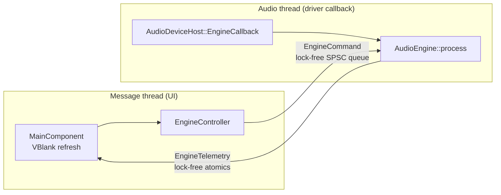

# The Dojo: architecture

This document describes the foundation laid in Phase 1 and the rules every later phase must follow.

## 1. Stack

| Concern | Choice | Why |
|---|---|---|
| Language | **C++20** | Deterministic, GC-free execution with direct control over memory and threads. It is the native language of every plug-in SDK (VST3, CLAP) and audio driver API (ASIO, WASAPI, ALSA, JACK). |
| Build | **CMake ≥ 3.22 + Ninja / Visual Studio**, `CMakePresets.json`, `FetchContent` | One build description for both OSes. Dependencies are pinned and fetched automatically, and presets give reproducible configurations for local builds and CI. |
| Audio I/O, MIDI, plug-in hosting, file formats, DSP | **JUCE 9.0.4** (`juce_audio_*`, `juce_dsp`) | A single API over ASIO / WASAPI / DirectSound and ALSA / JACK, plus hot-pluggable MIDI device I/O, VST3 hosting, WAV/FLAC/MP3 codecs and SIMD DSP building blocks. It's the industry-standard framework, with a decade of production use in commercial DAWs and plug-ins. |
| GUI | **JUCE `juce_gui_basics`**, custom look-and-feel | It draws every pixel itself, so the UI is identical on Windows (Direct2D) and Linux (X11). Fonts are embedded and the window chrome is drawn by JUCE, so even text metrics and title bars match. |
| CLAP hosting (later phase) | `free-audio/clap` + `clap-helpers` (MIT) | JUCE hosts VST3 natively, and CLAP is added through the official SDK. |
| Tests | Catch2 v3 | The suite exercises the real engine headless, with the allocation trap armed. |

**Rejected alternatives.** Rust has excellent safety properties, but its plug-in *hosting* and GUI ecosystems (VST3/CLAP hosts, ASIO, a production-grade cross-platform widget toolkit) are still immature for a full DAW. Garbage-collected runtimes (C#, Java, Go, JS) are excluded by the real-time rules.

## 2. Source layout and layering

```
src/
  core/     pure C++20, no JUCE: lock-free SPSC queue, RT guards + allocation trap,
            musical-time maths, shared types, generated Version.h
  engine/   AudioEngine (real-time state + process()), command/telemetry protocol,
            EngineController (the UI's façade), io/AudioDeviceHost (driver binding), dsp/
  ui/       DojoLookAndFeel + theme tokens, MainComponent and panels
  app/      JUCEApplication (UI-thread entry), MainWindow, CLI options, smoke test
resources/  embedded fonts (OFL)
tests/      Catch2 suite
cmake/      options, compiler policy, pinned dependencies
```

Each layer may depend only on the layers above it in this list. The UI never touches `AudioEngine` directly. It goes through `EngineController`.

JUCE's modules are compiled **once** into the `dojo::juce` static library, and the app, engine and tests all link that library.

## 3. Threads



| Thread | Entry point | Owner |
|---|---|---|
| Message / UI | `DojoApplication::initialise()` (via `START_JUCE_APPLICATION`) | JUCE |
| Audio | `AudioDeviceHost::EngineCallback::audioDeviceIOCallbackWithContext()` → `AudioEngine::process()` | The audio driver (ASIO / WASAPI / ALSA / JACK). JUCE raises it to real-time priority (MMCSS "Pro Audio" on Windows, `SCHED_FIFO` on Linux when permitted). |
| *Engine workers* (Phase 3) | Fixed pool of N−1 real-time threads | Engine. They process independent tracks and busses in parallel and are woken per block by the audio thread through lock-free signalling. |
| *Disk streaming* (Phase 3) | Background reader for audio clips | Engine |
| *Plug-in scanner* (plug-in phase) | Separate child process, so a crashing plug-in can't take down the DAW | App |

## 4. Real-time rules and how they are enforced

Code reachable from `AudioEngine::process()` must never:

* allocate or free heap memory,
* take a lock, wait on a condition, sleep or do I/O,
* call into the UI, log, or throw.

How the rules are enforced:

| Mechanism | What it does |
|---|---|
| `dojo::rt::ScopedRealtimeSection` + allocation trap (`src/core/rt/AllocationTrap.cpp`) | Replaces global `operator new`/`delete`. Any heap traffic on a thread inside a real-time section is counted. The count is shown in the status bar of non-Release builds, and the suite asserts it stays at zero across ~10 s of randomised rendering. ASan/TSan builds omit the trap, because their runtimes own the allocator. |
| `rt::SpscQueue<T>` | Bounded, wait-free, cache-line-padded ring buffer. `T` must be trivially copyable, so copying an element can't allocate, lock or throw. Its memory ordering is verified by a 2-million-element cross-thread test under ThreadSanitizer (`linux-tsan` preset). |
| `EngineCommand` is a `std::variant` of trivially-copyable structs | A `static_assert` keeps it that way. |
| `rt::ThreadOwnershipChecker` | Asserts that the single-producer queue is only fed from one thread. |
| `juce::ScopedNoDenormals` | FTZ/DAZ for the duration of the callback. |
| Sub-block rendering | Drivers that over-deliver frames can never overrun pre-allocated buffers. |
| `--smoke-test` in CI | Launches the real app on both OSes and fails on any RT violation. |

**One caveat, stated plainly.** JUCE's driver layer (and essentially every driver abstraction, PortAudio and RtAudio included) brackets each callback with a mutex. That mutex is only ever contended while a device starts or stops, and no audio is being rendered then. In steady state it is an uncontended user-space atomic: no syscall, no blocking. The Dojo's own code takes no locks on the audio thread at all.

## 5. UI → audio: commands

```
UI widget -> EngineController::play()/setMasterGainDecibels()/...
          -> EngineCommand (trivially copyable)
          -> AudioEngine::post()  [wait-free push]
          -> drained at the start of the next audio block
```

The queue is bounded, so pushes can fail. The only realistic case is when no device is running and nothing drains the queue. In that case `EngineController` parks commands in a message-thread outbox and retries them in FIFO order on a timer. Consecutive *coalescable* commands are merged there. These are absolute setters such as gain, where only the newest value matters. Nothing is silently dropped.

**Large objects (from Phase 2/3).** A rebuilt processing graph, a new plug-in instance or a loaded sample is constructed on the message thread and handed over by pointer in a command. The object it replaces travels back through a lock-free *return queue* and is destroyed on the message thread. The audio thread never frees memory.

## 6. Audio → UI: telemetry

Continuous status (peak levels, DSP load, playhead, transport state) is published through individual lock-free atomics in `EngineTelemetry`. A queue would be the wrong tool here: only the latest value matters.

Peak values are "max since last read". The audio thread raises them with a CAS max and the UI collects and resets them with `exchange(0)` once per frame, so a one-sample transient can't fall between two UI frames.

The UI **pulls** telemetry from a `juce::VBlankAttachment` callback once per display refresh. The audio thread never calls into the UI.

## 7. Signal path and precision

The internal mix runs in `double` (`dojo::Sample`). Conversion to and from the driver's `float` happens once, at the device edge. Phase 1 path:

```
test tone -> 64-bit master bus -> smoothed master gain -> metering -> float device buffers
```

The track/bus graph inserts ahead of the master bus in Phase 3.

## 8. Start-up and shutdown order

```
initialise: logger -> look-and-feel -> AudioEngine -> AudioDeviceHost (opens device; audio starts)
            -> EngineController -> MainWindow
shutdown:   MainWindow -> EngineController -> AudioDeviceHost (device stopped; no callback in flight)
            -> AudioEngine -> look-and-feel -> logger
```

## 9. Windows / Linux parity policy

* **One code path.** Platform differences live only inside JUCE and the build scripts.
* **Plug-in formats: VST3 and CLAP only.** Both exist on both OSes. LV2, LADSPA and AU are deliberately disabled because they would create features that only one OS has.
* **Audio back-ends** are platform-native, with feature-equivalent capabilities. Windows: ASIO, WASAPI (shared/exclusive), DirectSound. Linux: ALSA, JACK. PulseAudio and PipeWire are reached through their ALSA PCM plug-ins and PipeWire's JACK implementation.
* **Visual parity:** embedded Inter and JetBrains Mono fonts, plus JUCE-drawn window chrome.
* **CI** builds, tests and smoke-runs the real app on Ubuntu (GCC and Clang) and Windows (MSVC) for every push, with warnings treated as errors.

## 10. Licensing note

JUCE 9 is dual-licensed: AGPLv3 or a commercial JUCE licence. The bundled ASIO SDK is GPLv3 or a Steinberg licence. Distributing The Dojo as closed source therefore requires a commercial JUCE licence and a Steinberg ASIO licence. Distributing it as open source requires an AGPLv3-compatible licence. The embedded fonts are SIL OFL 1.1.
